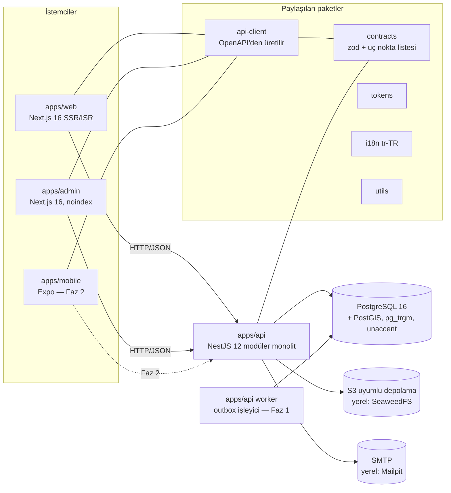
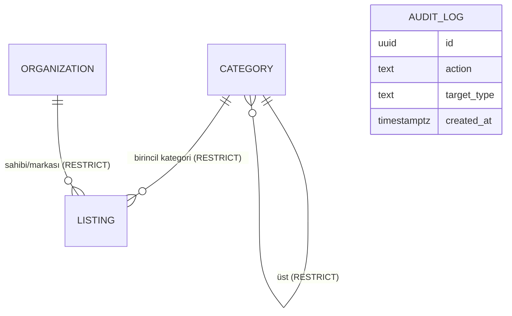
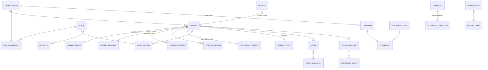

# Mimari (REQ-MIM-003)

Son güncelleme: 2026-10-19 (Faz 0). Kararlar: `docs/DECISIONS/ADR-0001…0010`.

## Bileşen diyagramı

**Kural:** Veritabanına yalnızca `apps/api` erişir (dependency-cruiser `db-only-in-api`). Organik sıralama modülleri (`search`, `catalog`, `reviews`) reklam/ticaret modüllerini içe aktaramaz (`organic-ranking-independent`).

## Veri modeli

### Faz 0'da kurulan tablolar

- `categories`: ağaç, izinli türler (`allowed_kinds`), durum, YMYL/lisans/sponsorluk bayrakları, `data_origin`.
- `organizations`: tür (BUSINESS, BRAND, CHAIN, OPERATOR, ADVERTISER).
- `listings`: ortak alanlar (REQ-VER-001); CHECK: `price_level` 1–4, PUBLISHED ⇒ `published_at`.
- `audit_log`: UPDATE/DELETE/TRUNCATE tetikleyiciyle engelli (REQ-VER-017).
- Eklentiler: `postgis`, `pg_trgm`, `unaccent`.

### Hedef model (Faz 1–3; Ek A2 ve ADR-0004)

## İzin matrisi (prompt v2 Ek A3'ten; her hücre Faz 1'de bir yetkilendirme testine bağlanır)

**Rol matrisi (özet; ayrıntı HSP.md'de):**

| Eylem | Süper yön. | Yönetici | Editör | Yazar | Moderatör | Satış/Sponsorluk | Üye | İşletme t. (F3) | Reklamveren t. (F3) |
|---|---|---|---|---|---|---|---|---|---|
| Rol atama, sistem ayarları, hukuki kapı açma talebi | ✔ | — | — | — | — | — | — | — | — |
| Kategori/özellik şeması yönetimi | ✔ | ✔ | — | — | — | — | — | — | — |
| Listeleme oluşturma/düzenleme | ✔ | ✔ | ✔ | taslak | — | — | düzeltme önerisi | kendi listelemesi: öneri (onaylı) | — |
| İçerik yayımlama | ✔ | ✔ | ✔ | taslak + incelemeye gönder | — | — | — | — | — |
| Editör değerlendirmesi/puanı | ✔ | ✔ | ✔ | taslak | — | **—** (yayından önce görmez) | — | — | — |
| Kullanıcı değerlendirmesi moderasyonu | ✔ | ✔ | — | — | ✔ | — | bildir | bildir + yanıt | — |
| Sponsorluk kampanyası/yerleşim | ✔ | ✔ (tutar alanı: yönetici) | sponsorlu içerik metni | — | — | ✔ (ticari alanlar, kreatif; onay yönetici) | — | — | kendi kampanyası: başvuru/rapor |
| Affiliate bağlantı yönetimi | ✔ | ✔ | bağlantı ekleme (izinli alanlar) | — | — | bağlantı ekleme (izinli alanlar) | — | — | — |
| Denetim kaydı görüntüleme | ✔ | ✔ (salt okunur) | — | — | kendi işlemleri | kendi işlemleri | — | — | — |
| Kişisel veri dışa aktarma (kullanıcı adına) | ✔ | — | — | — | — | — | kendi verisi | — | — |

## Render ve önbellek

ADR-0009 tablosu.
