# Bulgular — Yazılım mimarisi, API ve veri modeli (architecture-data)

## Özet

v1 doğru yönde birçok niyet içeriyor (modüler monolit, ortak içerik çekirdeği, "tabloları körü körüne ayrı kurma", gerçek olay kayıtlarından metrik, migration ve yedekleme), ancak mimari ve veri modeli açısından **karar vermiyor, karar verme ölçütü de vermiyor**. Ajan; monorepo düzeni, modül sınırları, API sözleşmesinin tek kaynağı, web ve mobil için kimlik doğrulama modeli, içerik çekirdeğinin şekli, arama, coğrafi model, önbellek geçersiz kılma ve migration güvenliği konularında kendi başına ve muhtemelen tutarsız seçimler yapacaktır.

En kritik sorunlar şunlar:
1. **Çelişki:** §4 "yeni kategoriler kod yazmadan eklenir" diyor, §12 ise Hotels, Products, CarRentalProviders, TourGuides gibi dikeye özel tablolar sayıyor. Bu çelişki, "kategori = veri, tür (kind) = kod" ayrımıyla çözülmelidir.
2. **Model belirsizliği:** §12'deki düz varlık listesi; Entity/Listing, Article, editör incelemesi, kullanıcı yorumu, yorum (comment), puan ve medya kavramlarını karıştırıyor. "İşletme sahibi" ve "Reklamveren" global rol olarak tanımlanmış. Bunlar global rol değil, organizasyona bağlı üyeliklerdir.
3. **Sponsorlu içerik garantisi:** Sponsorlu içeriğin organik sıralamayı etkilememesi (§8) ve etiketlenmesi (§9) yalnızca politika olarak yazılmış. Mimari düzeyde (ayrı servis, API sözleşmesinde zorunlu açıklama alanı, test) güvenceye alınmamış.
4. **Önbellek hatası:** ISR/CDN önbelleği yüzünden süresi biten sponsorlu kampanyanın yayında kalması gibi gerçek hatalar öngörülmemiş.
5. **Türkçe arama:** Ayrıntı verilmemiş. `turkish` yapılandırması, `unaccent` fonksiyonunun IMMUTABLE olmaması ve İ/ı büyük-küçük harf dönüşümü gibi tuzaklar anılmamış.
6. **Veri yaşam döngüsü:** Silme, anonimleştirme, değiştirilemez denetim kaydı, outbox ve idempotent işler tanımsız.

Bu dosya; somut klasör yapısını, modül sınırlarını, API konvansiyonlarını (RFC 9457, cursor sayfalama, Idempotency-Key, ETag/If-Match), ER taslağını (mermaid), indeks listesini, migration kurallarını ve ölçülebilir kabul kriterlerini v2'ye eklenecek metin olarak öneriyor.

## Yapı önerileri

- v2'de §2 "Teknik kısıtlar" iki bölüme ayrılmalı. "2A. Değişmez kısıtlar" yasakları ve zorunluları içermeli. "2B. Varsayılan kararlar" ise ajanın aksi gerekçelendirilmedikçe uygulayacağı somut seçimleri içermeli (pnpm + Turborepo, NestJS, Prisma + ham SQL migration, PostGIS, BullMQ).
- "Mimari ve Veri" için ayrı, numaralı bir ana bölüm açılmalı ve şu alt başlıkları içermeli: (a) Monorepo ve çalışma zamanı topolojisi, (b) Modül sınırları, (c) API sözleşmesi ve konvansiyonlar, (d) Kimlik doğrulama ve yetkilendirme, (e) Çekirdek veri modeli ve ER şeması, (f) Arama, (g) Coğrafya, saat ve para, (h) Olaylar, kuyruklar ve önbellek, (i) Medya hattı, (j) Veri yaşam döngüsü (silme, saklama, denetim), (k) Migration ve performans bütçeleri. v1 §12'nin düz listesi kaldırılmalı ve yerine ER şeması konmalı.
- Her alt bölüm "Karar / Kural / Kabul kriteri" üçlüsüyle yazılmalı. Kabul kriterleri test edilebilir olmalı (ör. "p95 < 300 ms, k6 senaryosu X ile ölçülür").
- Ajandan ilk teslimde `docs/architecture/` altında ADR'ler (Architecture Decision Record), ER diyagramı, OpenAPI dosyası ve izin matrisi istenmeli. Kod yazmaya bu dokümanlardan sonra geçilmeli. v1 §22 adım 4 bu çıktılara bağlanmalı.
- Faz planı (§19) veri modeli açısından yeniden yazılmalı. Şema Faz 1'de tüm fazları taşıyacak çekirdeği içermeli (kampanya, organizasyon, mobil token akışı). Arayüzler fazlara yayılabilir.
- Sponsorlu içerik ve organik ayrımı, "politika" bölümünde değil mimari bölümünde **zorunlu kontrol (invariant)** olarak tanımlanmalı ve test listesine bağlanmalı.

## Bulgular

### ARCHITECTURE-DATA-01 — Monorepo düzeni, paket sınırları ve mimari dokümantasyon somut tanımlanmalı
- v1 bölüm: 2, 21, 22  ·  tür: eksik  ·  öncelik: P0  ·  doğrulandı: evet
- Gerekçe: v1 yalnızca "düzenli bir monorepo oluştur" diyor. Web, admin, API ve mobil arasında ortak tip, doğrulama ve tasarım token'larının nasıl paylaşılacağı tanımlanmamış. Ajan ya her uygulamada tipleri kopyalar ya da Next.js'ten doğrudan veritabanına erişen bir yapı kurar. İkisi de sürdürülemez.
- Kaynaklar: —
- Önerilen metin:

```
## Monorepo yapısı (varsayılan karar; değiştirirsen ADR yaz)

Araçlar: pnpm workspaces + Turborepo. Node.js'in güncel LTS sürümü (sürümü .nvmrc ve package.json "engines" alanında sabitle). TypeScript "strict": true.

incelemeler/
├─ apps/
│  ├─ web/          # Next.js (App Router) — son kullanıcı sitesi, SSR/ISR
│  ├─ admin/        # Next.js — yönetim paneli + işletme/reklamveren portalı (ayrı alan adı)
│  ├─ api/          # NestJS — iki giriş noktası: main.ts (HTTP API) ve worker.ts (BullMQ işleyicileri)
│  └─ mobile/       # Expo / React Native (Expo Router)
├─ packages/
│  ├─ contracts/    # zod şemaları: DTO'lar, enum'lar, içerik blok şemaları, hata kodları (tek doğruluk kaynağı)
│  ├─ api-client/   # OpenAPI'den ÜRETİLEN tipli istemci (elle düzenleme yasak)
│  ├─ tokens/       # tasarım token'ları (JSON) → Tailwind preset + React Native tema çıktısı
│  ├─ ui-web/       # web + admin ortak React bileşenleri
│  ├─ ui-native/    # mobil ortak bileşenler
│  ├─ utils/        # saf fonksiyonlar: slugifyTr, para formatı, saat dilimi, Türkçe normalize
│  └─ config/       # eslint, tsconfig, prettier, jest/vitest ortak ayarları
├─ infra/           # docker-compose (postgres+postgis, redis, minio, mailpit), IaC taslakları
├─ docs/
│  ├─ architecture/ # ADR'ler (docs/architecture/adr/NNNN-baslik.md), ER diyagramı, izin matrisi
│  └─ api/          # üretilmiş openapi.json + değişiklik günlüğü
└─ turbo.json

Bağımlılık kuralları (eslint "boundaries" veya dependency-cruiser ile CI'da zorunlu kıl):
- Veritabanına (Prisma Client) YALNIZCA apps/api erişir. apps/web, apps/admin ve apps/mobile veritabanına doğrudan bağlanmaz; yalnızca packages/api-client üzerinden API'yi çağırır.
- packages/* hiçbir zaman apps/* içinden import yapmaz.
- packages/contracts tarayıcı ve React Native'de çalışabilmelidir: Node'a özgü modül içermez.
- Döngüsel bağımlılık CI'da hata verir.

İlk teslim (kod yazmadan önce) docs/architecture/ altında şunları üret:
1. Kısa mimari özeti (bileşen diyagramı, mermaid).
2. ER diyagramı (mermaid) ve tablo sözlüğü.
3. İzin matrisi (rol × eylem tablosu).
4. En az şu konularda ADR: monorepo aracı, ORM ve ham SQL kullanım sınırı, kimlik doğrulama modeli, içerik çekirdeği modeli, arama yaklaşımı, admin'in ayrı uygulama olması, kuyruk/outbox tasarımı.

Kabul kriteri: `pnpm install && pnpm turbo run lint typecheck test build` temiz bir klonda tek komutla geçer; `docker compose up` ile api + web + admin yerelde ayağa kalkar; bağımlılık kuralı ihlali CI'ı kırar.
```

### ARCHITECTURE-DATA-02 — Çalışma zamanı topolojisi: API, worker, web, admin ayrımı
- v1 bölüm: 2, 11  ·  tür: belirsiz  ·  öncelik: P1  ·  doğrulandı: evet
- Gerekçe: v1, admin'in web içinde mi yoksa ayrı bir uygulama olarak mı çalışacağını belirtmiyor. Arka plan işlerinin HTTP sürecinde çalışması, uzun işlerin API gecikmesini bozmasına yol açar. Admin'in genel siteyle aynı origin'de olması da çerez, CSP ve SEO riskleri doğurur.
- Kaynaklar: https://nextjs.org/docs/app/api-reference/functions/middleware (Next.js 16'da `middleware` dosya konvansiyonu `proxy` olarak yeniden adlandırıldı)
- Önerilen metin:

```
## Çalışma zamanı topolojisi

| Süreç | Alan adı | Görev | Ölçekleme |
|---|---|---|---|
| web (Next.js) | incelemeler.com.tr | Genel site, SSR/ISR, sitemap, /.well-known dosyaları | yatay |
| admin (Next.js) | panel.incelemeler.com.tr | Personel paneli + işletme/reklamveren portalı | yatay, düşük trafik |
| api (NestJS HTTP) | api.incelemeler.com.tr | REST /v1 | yatay, durumsuz |
| worker (NestJS standalone) | — (HTTP yok) | BullMQ işleyicileri, zamanlanmış işler, outbox aktarıcısı | iş türüne göre yatay |
| postgres (+PostGIS, pg_trgm, unaccent) | özel ağ | ana veri | yönetilen servis, PITR yedek |
| redis | özel ağ | kuyruk, oturum/rate-limit, kısa süreli önbellek | yönetilen |
| nesne depolama (S3 uyumlu) + CDN | media.incelemeler.com.tr | medya | — |

Kurallar:
- Admin ayrı bir uygulamadır. Genel site paketine admin kodu girmez. Admin sayfaları `noindex` ile işaretlenir ve robots.txt ile kapatılır. Admin ayrı çerez adı ve daha sıkı bir CSP kullanır. Personel girişinde 2FA zorunludur (bkz. ARCHITECTURE-DATA-08).
- api ve worker aynı kod tabanından (apps/api) iki ayrı süreç olarak çalışır. HTTP isteği içinde 1 saniyeden uzun sürebilecek iş (görsel işleme, e-posta, arama indeksleme, rapor üretimi) YAPILMAZ; kuyruğa atılır.
- Next.js'in istek ara katmanı için kullanılan Next.js sürümünün güncel konvansiyonunu kullan (Next.js 16'da `middleware.ts` → `proxy.ts`). Kullanımdan kaldırılmış API'lerle başlama.
- Tüm süreçler aynı yapılandırma şemasını (zod ile doğrulanan env) kullanır. Eksik veya geçersiz env ile süreç AÇILMAZ (fail-fast).
- Her süreç /healthz (canlılık) ve /readyz (DB + Redis erişimi) uç noktalarını sunar.
```

### ARCHITECTURE-DATA-03 — NestJS modüler monolit: modül sınırları ve iletişim kuralları
- v1 bölüm: 2, 12  ·  tür: eksik  ·  öncelik: P0  ·  doğrulandı: evet
- Gerekçe: "Modüler monolit" demek yetmez. Modüller tanımlanmazsa her servis her tabloya dokunur ve ileride servis ayırmak imkânsız hale gelir. Ayrıca ticari modüllerin (ads) organik sıralama koduna sızması güven ilkesini mimari düzeyde bozar.
- Kaynaklar: —
- Önerilen metin:

```
## Backend modül sınırları (apps/api/src/modules/*)

| Modül | Sahip olduğu tablolar (özet) | Not |
|---|---|---|
| identity | users, credentials, oauth_accounts, sessions, refresh_tokens, mfa_factors | kimlik doğrulama |
| access | roles, permissions, role_permissions, staff_roles, org_memberships | yetkilendirme, policy servisi |
| taxonomy | categories, category_closure, attribute_definitions, attribute_schema_versions, tags | |
| geo | admin_areas, destinations, addresses | PostGIS |
| catalog | entities, entity_* uzantı tabloları, organizations, entity_claims, opening_hours | listelemeler |
| editorial | articles, content_revisions, article_entities, authors | blok içerik |
| reviews | user_reviews, review_ratings, review_votes, business_replies, editorial_scores, rating_stats | |
| moderation | reports, moderation_cases, moderation_actions | |
| media | media_assets, media_variants, media_usages | |
| search | search_documents, synonyms, search_events (ham) | okuma modeli |
| commerce | providers, outbound_links, outbound_clicks, offers, price_snapshots | afiliye/yönlendirme |
| ads | advertisers (organization referansı), campaigns, placements, creatives, ad_events, campaign_daily_stats | sponsorlu |
| engagement | favorites, collections, collection_items, view_history | |
| notifications | notifications, notification_prefs, push_devices | |
| analytics | analytics_events (bölümlenmiş), günlük özet tabloları | |
| platform | feature_flags, settings, redirects, slugs, outbox_events, audit_log, idempotency_keys | ortak altyapı |

Kurallar:
- Bir modül başka bir modülün tablosuna Prisma ile DOĞRUDAN yazmaz. Başka modülün verisini o modülün dışa açtığı servis arayüzü üzerinden okur veya domain olayı (outbox) yayınlar.
- Okuma amaçlı birleşik sorgular (ör. arama, liste kartı) yalnızca `search` modülünün okuma modeli veya açıkça "query service" olarak işaretlenmiş sınıflarda yapılır.
- `search` ve `catalog` modülleri `ads` modülünü import ETMEZ. Organik sıralama kodunun kampanya verisine erişimi yoktur. Sponsorlu yerleşimler sunum katmanında (BFF/controller) ayrı bir çağrıyla birleştirilir (bkz. ARCHITECTURE-DATA-16).
- Döngüsel modül bağımlılığı (forwardRef) yasaktır. Gerekirse olay kullan.
- Her modülün `index.ts` dosyası yalnızca dışa açık servisleri ve tipleri export eder. Kural dependency-cruiser ile CI'da denetlenir.
```

### ARCHITECTURE-DATA-04 — API sözleşmesi "gerektiğinde" değil, tek kaynaktan ve zorunlu olarak üretilmeli
- v1 bölüm: 2 ("REST API ve gerektiğinde OpenAPI dokümantasyonu")  ·  tür: hatalı  ·  öncelik: P0  ·  doğrulandı: evet
- Gerekçe: Üç istemci (web, admin, mobil) aynı API'yi kullanacağı için OpenAPI "gerektiğinde" değil, zorunlu ve makine tarafından üretilen bir sözleşme olmalı. Elle yazılan istemci tipleri hızla API'den sapar. Mobil uygulama eski sürümlerde kalacağı için kırıcı değişikliklerin CI'da yakalanması gerekir.
- Kaynaklar: —
- Önerilen metin:

```
## API sözleşmesi (contract-first)

- Tek doğruluk kaynağı packages/contracts içindeki zod şemalarıdır. NestJS DTO'ları bu şemalardan türetilir (ör. nestjs-zod veya eşdeğeri; seçimini ADR'de gerekçelendir). İstek doğrulaması aynı şemayla yapılır. Doğrulanmamış hiçbir gövde, sorgu parametresi veya başlık servis katmanına ulaşmaz.
- OpenAPI 3.1 belgesi koddan OTOMATİK üretilir, docs/api/openapi.json olarak depoya yazılır ve CI'da "üretilen dosya güncel mi" kontrolü yapılır.
- packages/api-client bu belgeden üretilir (ör. openapi-typescript + ince bir fetch sarmalayıcı). Web, admin ve mobil YALNIZCA bu istemciyi kullanır.
- Üç ayrı belge üret: public (/v1), business (/v1/business), admin (/v1/admin). Admin belgesi genel dokümantasyon sitesinde yayınlanmaz.
- CI'da önceki sürümün openapi.json'u ile karşılaştırma yapan bir kırıcı değişiklik denetimi (ör. oasdiff) çalıştır. /v1 altında alan silme, tip değiştirme veya zorunlu alan ekleme CI'ı kırar. Bu tür bir değişiklik ya geriye uyumlu yapılır ya da /v2 açılır.
- Mobil uyumluluk: API, en az son 2 yayınlanmış mobil sürümün kullandığı sözleşmeyi destekler. Mobil istemci her istekte `X-Client: mobile/<sürüm>/<platform>` başlığı gönderir. Desteklenmeyen sürümler 426 yerine RFC 9457 hata gövdesi ve `code: "CLIENT_UPGRADE_REQUIRED"` alır; uygulama bu durumda güncelleme ekranı gösterir.

Kabul kriteri: contracts'ta bir alanın adını değiştirmek web, admin ve mobilde typecheck hatası üretir; openapi.json güncellenmeden yapılan PR CI'da düşer.
```

### ARCHITECTURE-DATA-05 — API konvansiyonları: sürümleme, adlandırma, sayfalama, filtre/sıralama, hata formatı
- v1 bölüm: YENİ  ·  tür: eksik  ·  öncelik: P0  ·  doğrulandı: evet
- Gerekçe: v1'de hiçbir API konvansiyonu yok. Liste, arama ve harita uç noktaları sonsuz kaydırma ve harita kaydırması ile çalışacağı için offset sayfalama hem yavaş hem de tutarsızdır (yeni kayıt eklendiğinde öğeler kayar ya da tekrarlanır). Hata formatı standart değilse üç istemci üç ayrı hata ayrıştırıcı yazar. RFC 9457 (Temmuz 2023) RFC 7807'nin yerini almıştır.
- Kaynaklar: https://www.rfc-editor.org/rfc/rfc9457.html · https://datatracker.ietf.org/doc/rfc9457/
- Önerilen metin:

```
## API konvansiyonları

Genel
- Taban: https://api.incelemeler.com.tr/v1. Kaynak adları çoğul ve kebab-case (/v1/entities, /v1/articles, /v1/user-reviews). JSON alan adları camelCase.
- Tüm zaman damgaları ISO 8601 biçiminde, UTC ve "Z" sonekiyle (2026-10-18T09:30:00Z). Yerel tarih ve saat alanları ayrı tiplerle verilir (bkz. ARCHITECTURE-DATA-22).
- Kimlikler (id) opak dizelerdir. İstemci kimliğin yapısına dayanmaz.
- Dil: `Accept-Language` (varsayılan tr-TR). Yanıtta `Content-Language` döner.

Sayfalama (cursor tabanlı, offset YASAK — admin tabloları hariç)
- İstek: ?limit=20&cursor=<opak>. limit için varsayılan 20, en fazla 100.
- Yanıt: { "data": [...], "page": { "nextCursor": "…" | null, "hasMore": bool } }
- Cursor; sıralama anahtarı ve id içeren, base64url ile kodlanmış, HMAC ile imzalanmış bir değerdir. Sıralama her zaman benzersiz bir id ile bağlanır (ORDER BY score DESC, id DESC).
- Admin tablolarında toplam sayı gerekiyorsa offset + `total` kullanılabilir (ama en fazla 10.000 satır).

Filtre ve sıralama
- Filtre: düz ve beyaz listeye alınmış parametreler. Örnek: ?category=oteller&area=antalya&priceLevel=1,2&ratingMin=4&attr.hasPool=true&near=36.88,30.70&radiusKm=10
- Kategoriye özgü filtreler `attr.<key>` önekiyle gelir ve yalnızca o kategorinin attribute_definitions tablosunda `filterable=true` olan anahtarlar kabul edilir. Bilinmeyen parametre 400 döndürür.
- Sıralama: ?sort=-ratingAvg,name. İzin verilen alanlar her uç nokta için sabit bir listede tanımlanır. "relevance" yalnızca q parametresi varken geçerlidir.
- Sponsorlu sıralama diye bir parametre YOKTUR.

Hata formatı — RFC 9457 (application/problem+json)
{
  "type": "https://incelemeler.com.tr/problems/validation-error",
  "title": "İstek doğrulanamadı",
  "status": 422,
  "detail": "Bir veya daha fazla alan geçersiz.",
  "instance": "/v1/user-reviews",
  "code": "VALIDATION_FAILED",           // kararlı makine kodu; packages/contracts'ta enum
  "traceId": "4bf92f3577b34da6a3ce929d0e0e4736",
  "errors": [ { "pointer": "/body/rating", "code": "TOO_SMALL", "message": "Puan 1 ile 5 arasında olmalıdır." } ]
}
- Kullanıcıya gösterilecek Türkçe mesajlar istemcide `code` üzerinden eşlenir. `detail` alanı yığın izi, SQL veya iç bilgi İÇERMEZ.
- Durum kodu tablosu: 400 bozuk istek, 401 kimlik yok, 403 yetki yok, 404 yok (yetkisiz kaynaklar için de 404 kullanılabilir), 409 çakışma, 412 sürüm uyuşmazlığı, 422 doğrulama, 428 If-Match eksik, 429 hız sınırı (Retry-After başlığıyla), 5xx sunucu.

Kabul kriteri: tüm uç noktaların 4xx/5xx yanıtları contract testlerinde problem+json şemasına karşı doğrulanır; offset parametresi kabul eden genel (public) bir uç nokta yoktur.
```

### ARCHITECTURE-DATA-06 — Idempotency, eşzamanlılık kontrolü ve HTTP önbellek başlıkları
- v1 bölüm: YENİ  ·  tür: eksik  ·  öncelik: P1  ·  doğrulandı: evet
- Gerekçe: Mobil ağlarda POST istekleri tekrarlanır. Aynı yorumun iki kez oluşması ya da kampanya ve ileride ödemenin iki kez yaratılması bu yüzden gerçek bir risktir. Aynı içeriği iki editörün aynı anda düzenlemesi de sessiz veri kaybına yol açar. `Idempotency-Key` başlığı IETF'de hâlâ taslak (Internet-Draft) aşamasındadır, RFC değildir. Bu nedenle davranış kendi sözleşmemizde tanımlanmalıdır.
- Kaynaklar: https://datatracker.ietf.org/doc/draft-ietf-httpapi-idempotency-key-header/ · https://www.rfc-editor.org/rfc/rfc9110.html (ETag/If-Match/If-None-Match)
- Önerilen metin:

```
## Idempotency ve eşzamanlılık

Idempotency-Key (IETF taslağı esas alınarak kendi sözleşmemizde tanımlanır)
- Kaynak oluşturan şu POST uç noktaları `Idempotency-Key` (UUID) başlığını ZORUNLU tutar: kullanıcı yorumu oluşturma, işletme başvurusu, kampanya oluşturma, medya yükleme bitirme (finalize), yorum bildirimi (report) ve ileride ödeme.
- Sunucu tarafında `idempotency_keys(key, user_id|anon_fingerprint, route, request_hash, status, response_code, response_body, created_at)` tablosu tutulur ve kayıtlar 24 saat saklanır.
  - Aynı anahtar ve aynı gövde gelirse ilk yanıt aynen tekrar döner.
  - Aynı anahtar farklı bir gövdeyle gelirse 422 `IDEMPOTENCY_KEY_REUSED` döner.
  - İlk istek hâlâ işleniyorsa 409 `REQUEST_IN_PROGRESS` döner.
- Mobil ve web istemcisi anahtarı kullanıcının eylemi başına bir kez üretir ve yeniden denemelerde aynı anahtarı kullanır.

İyimser kilitleme (optimistic concurrency)
- Düzenlenebilir tüm yönetim kaynaklarında (entity, article, campaign, category, attribute schema) `version INT` sütunu bulunur.
- GET yanıtı `ETag: W/"<version>"` döner. PATCH/PUT istekleri `If-Match` başlığını zorunlu tutar: başlık eksikse 428, sürüm eşleşmezse 412 `VERSION_CONFLICT` döner. Admin arayüzü 412 alındığında "Bu içerik siz düzenlerken değiştirildi" uyarısı ve fark (diff) görünümü sunar.

HTTP önbellek başlıkları
- Genel ve kişiselleştirilmemiş GET uç noktaları (entity detayı, kategori listesi, makale): `Cache-Control: public, max-age=60, stale-while-revalidate=300` ve güçlü veya zayıf ETag. `If-None-Match` geldiğinde 304 döner.
- Oturuma bağlı veya kişiselleştirilmiş yanıtlar (favoriler, profil, "beğendim" durumu): `Cache-Control: private, no-store`. Kişisel alanlar genel yanıtlara GÖMÜLMEZ. Detay sayfası genel veriyi bir çağrıyla, kullanıcı durumunu (isFavorite, myReview) ayrı bir çağrıyla alır. Böylece genel yanıt CDN'de önbelleğe alınabilir.
- Sponsorlu yerleşim yanıtları en fazla 60 sn önbelleğe alınır ve `Vary` başlığı doğru ayarlanır (bkz. ARCHITECTURE-DATA-27).
```

### ARCHITECTURE-DATA-07 — Kimlik doğrulama: web için oturum çerezi, mobil için döndürülen token, personel için zorunlu 2FA
- v1 bölüm: 6, 16 ("Güvenli oturum yönetimi")  ·  tür: eksik  ·  öncelik: P0  ·  doğrulandı: hayır
- Gerekçe: v1 yalnızca "güvenli oturum yönetimi" diyor. Web ile mobil için farklı ve doğru mekanizmalar tanımlanmazsa ajan büyük olasılıkla localStorage'da uzun ömürlü JWT kullanır. Bu hem XSS'e açıktır hem de oturum iptalini imkânsız kılar. Argon2id parametreleri OWASP'tan doğrulandı. Apple'ın 4.8 "Login Services" kuralının güncel metni ise birincil kaynaktan okunamadı. İkincil kaynaklar kuralın 2024 sonrası değiştiğini gösteriyor. Bu yüzden madde doğrulama talimatıyla yazıldı.
- Kaynaklar: https://cheatsheetseries.owasp.org/cheatsheets/Password_Storage_Cheat_Sheet.html · https://developer.apple.com/app-store/review/guidelines/#login-services (doğrulanamadı) · https://developer.apple.com/forums/thread/765145
- Önerilen metin:

```
## Kimlik doğrulama (authN)

Parola ve hesap
- Parola hash'i: Argon2id. Asgari parametreler OWASP Password Storage Cheat Sheet'e göre m=19 MiB, t=2, p=1'dir; sunucu kapasitesine göre artır. Parametreler hash dizesinin içinde saklanır. Parametre yükseltildiğinde kullanıcı bir sonraki girişte yeniden hash'lenir.
- E-posta: küçük harfe çevrilmiş ve normalize edilmiş biçimde benzersiz indekse alınır (citext veya lower() üzerinde unique index).
- E-posta doğrulama token'ı: 32 bayt rastgele değer, veritabanında yalnızca SHA-256 hash'i tutulur, 24 saat geçerlidir ve tek kullanımlıktır. Parola sıfırlama token'ı aynı yapıda, 30 dakika geçerli ve tek kullanımlıktır. Parola sıfırlanınca kullanıcının tüm oturumları iptal edilir.
- Yorum yazma, favori senkronizasyonu ve işletme başvurusu için e-posta doğrulaması zorunludur. Misafir gezinme hesap gerektirmez.

Web (incelemeler.com.tr ve panel.incelemeler.com.tr)
- Sunucu tarafında saklanan oturum kullanılır (sessions tablosu ve Redis önbelleği). Çerez özellikleri: `__Host-sid`, HttpOnly, Secure, SameSite=Lax, Path=/. JWT localStorage veya sessionStorage'a KONMAZ.
- Next.js sunucu tarafı API'ye BFF (backend-for-frontend) olarak çağrı yapar ve tarayıcıdaki oturumu API'ye aktarır. Bu mekanizmayı ADR'de kesinleştir.
- Durum değiştiren tüm isteklerde CSRF koruması uygulanır: SameSite=Lax'a ek olarak Origin/Referer kontrolü ve CSRF token'ı.
- Oturum ömrü: kayan 30 gün, mutlak 90 gün. Personel oturumu: kayan 12 saat. Kullanıcı aktif oturumlarını listeleyip tek tek iptal edebilir.

Mobil (Expo)
- Erişim token'ı: kısa ömürlü (10–15 dk) imzalı JWT. İçinde yalnızca sub, sid ve rol özeti bulunur; kişisel veri bulunmaz.
- Yenileme token'ı: opak ve rastgele bir değerdir; veritabanında hash olarak saklanır. HER kullanımda döndürülür (rotation). Aynı token aile içinde ikinci kez kullanılırsa (yeniden kullanım tespiti) tüm aile iptal edilir ve kullanıcıdan yeniden giriş istenir.
- Token'lar yalnızca cihazın güvenli deposunda (expo-secure-store; iOS Keychain / Android Keystore) tutulur. AsyncStorage'a yazılmaz.

Sosyal giriş
- Google ile giriş ve Sign in with Apple. Sağlayıcı kimliği (provider, provider_user_id) üzerinden eşleştirme yapılır. E-posta üzerinden otomatik hesap birleştirme YALNIZCA iki tarafta da doğrulanmış e-posta varsa ve kullanıcı onay verirse yapılır.
- Apple "gizli e-posta aktarma" adreslerini (privaterelay) destekle.
- App Store Review Guidelines 4.8 (Login Services) maddesinin güncel metni yayın öncesi developer.apple.com'dan doğrulanmalıdır. Kuralın son sürümleri, üçüncü taraf sosyal giriş sunan uygulamalardan belirli gizlilik özelliklerine sahip eşdeğer bir giriş seçeneği istemektedir; Sign in with Apple bu koşulu karşılayan seçenektir. Doğrulanamazsa madde hukuki/teknik inceleme listesine eklenmelidir.

Personel (super_admin, admin, editor, author, moderator)
- TOTP tabanlı 2FA ZORUNLUDUR. 2FA kurulmadan panel işlevleri açılmaz. 10 adet tek kullanımlık kurtarma kodu üretilir ve hash'lenmiş olarak saklanır. WebAuthn/passkey isteğe bağlı ikinci yöntem olarak desteklenir.
- Kritik işlemlerde (rol değiştirme, kampanya bütçesi, toplu silme, dışa aktarma) son 10 dakika içinde yeniden kimlik doğrulama (step-up) istenir.

Hız sınırları (Redis, kayan pencere)
- giriş: IP başına 10/dk, hesap başına 5/dk (sonrasında artan bekleme süresi)
- parola sıfırlama isteği: e-posta başına 3/saat
- kayıt: IP başına 5/saat
Aşımda 429 ve Retry-After döner. Hesabın var olup olmadığı yanıtlardan anlaşılamaz (kullanıcı adı numaralandırmasına karşı).

Kabul kriteri: e2e testinde (1) çalınmış bir refresh token'ın ikinci kullanımı tüm aileyi iptal eder; (2) 2FA'sız bir editör hesabı /v1/admin/* çağrısında 403 `MFA_REQUIRED` alır; (3) parola sıfırlandıktan sonra eski web oturumu 401 alır.
```

### ARCHITECTURE-DATA-08 — Yetkilendirme: "İşletme sahibi" ve "Reklamveren" global rol değil, organizasyon kapsamlı üyeliktir
- v1 bölüm: 11 (Roller)  ·  tür: hatalı  ·  öncelik: P0  ·  doğrulandı: evet
- Gerekçe: v1 sekiz rolü düz bir liste olarak veriyor. "İşletme sahibi" global bir rol olarak modellenirse, bu role sahip her kullanıcı her işletmeyi düzenleyebilir hale gelir. Bu klasik bir yatay yetki yükseltme (IDOR/BOLA) açığıdır. Bir kullanıcı aynı anda birden fazla işletmenin yetkilisi ve sıradan bir yorumcu olabilir. Ayrıca bir işletme yetkilisinin kendi işletmesine yorum yazması ve kendi işletmesine gelen yorumları moderasyona alması çıkar çatışmasıdır.
- Kaynaklar: —
- Önerilen metin:

```
## Yetkilendirme (authZ)

İki ayrı eksen kullan:
1. Personel rolleri (global): super_admin, admin, editor, author, moderator, sales_ops (kampanya operasyonu), analyst (salt okuma rapor). Kullanıcı başına sıfır veya daha fazla personel rolü olabilir.
2. Organizasyon üyelikleri (kaynak kapsamlı): org_memberships(user_id, organization_id, role ∈ {owner, manager, editor, billing}, status). "İşletme sahibi" ve "reklamveren" ayrı global roller DEĞİLDİR. Bir organizasyondaki üyelik, kullanıcıya YALNIZCA o organizasyonun sahip olduğu veya talep ettiği (claim) entity'ler ve kampanyalar üzerinde yetki verir.

İzinler
- İzinler `kaynak.eylem` biçiminde metin olarak tanımlanır (ör. article.publish, entity.update, review.moderate, campaign.create, campaign.approve, report.export, user.role.assign). Roller izin kümeleridir ve tohum (seed) ile oluşturulur. Panelden düzenlenebilir ama super_admin izinleri değiştirilemez.
- Kontrol tek bir PolicyService'te yapılır: can(actor, action, resource). Varsayılan cevap REDDETtir. Controller'larda dekoratör kullanılır (@Can('entity.update')). Kaynak kapsamlı kontrol servis katmanında, kaynak yüklendikten sonra yapılır (sahiplik kontrolü).
- Sorgu düzeyinde kapsam: işletme portalı sorguları her zaman `organization_id IN (actor.orgIds)` filtresiyle çalışır. Bu filtre repository katmanında zorunlu bir parametredir; unutulamaz.

Çıkar çatışması kuralları (kod düzeyinde zorunlu)
- Bir organizasyon üyesi, kendi organizasyonuna bağlı entity'lere kullanıcı yorumu YAZAMAZ (409 `CONFLICT_OF_INTEREST`).
- Bir organizasyon üyesi yorumları gizleyemez veya silemez. Yalnızca "işletme yanıtı" yazabilir ve moderasyona bildirim (report) gönderebilir.
- Bir personel, aktif üyesi olduğu organizasyonun yorumlarını moderasyona alamaz.
- Kampanya oluşturan kişi kendi kampanyasını onaylayamaz (dört göz ilkesi). Onay campaign.approve iznine sahip başka bir kişi tarafından verilir.

İzin matrisi docs/architecture/permissions.md içinde rol × izin tablosu olarak tutulur. Bu tablodan otomatik test üretilir: her (rol, uç nokta) çifti için beklenen 2xx/403/404 sonucu.

Kabul kriteri: A organizasyonunun owner'ı, B organizasyonunun entity'sine PATCH isteği gönderdiğinde 404 alır (varlık sızdırılmaz); izin matrisi testleri tüm admin ve business uç noktalarını kapsar (kapsama raporu %100).
```

### ARCHITECTURE-DATA-09 — "Kategori = veri, tür (kind) = kod" ayrımı (§4 ile §12 çelişkisinin çözümü)
- v1 bölüm: 4, 12  ·  tür: çelişki  ·  öncelik: P0  ·  doğrulandı: evet
- Gerekçe: §4 yeni kategorilerin kod yazmadan eklenmesini istiyor. §12 ise Hotels, Products, CarRentalProviders, TourGuides ve Activities gibi dikeye özel tablolar listeliyor. Bu tablolar korunursa her yeni dikey için kod ve migration gerekir. Tamamen tiplenmemiş bir model kurulursa da harita, çalışma saatleri, oda tipleri gibi davranışlar yazılamaz. Çözüm, davranışı belirleyen küçük ve sabit bir "kind" kümesi ile veriyle yönetilen sınırsız bir kategori ağacını birbirinden ayırmaktır.
- Kaynaklar: —
- Önerilen metin:

```
## Tür (kind) ve kategori ayrımı — bağlayıcı kural

- `entity.kind` kodda tanımlı, KÜÇÜK ve SABİT bir enum'dur. Davranışı (hangi uzantı tablosu, hangi CTA tipleri, hangi schema.org tipi, haritada görünüp görünmediği, çalışma saati olup olmadığı) belirler:
  PLACE (restoran, kafe, müze, plaj, kuaför gibi fiziksel konum), LODGING (konaklama), PRODUCT (fiziksel veya dijital ürün, model bazında), SERVICE_PROVIDER (araç kiralama, transfer, temizlik, seyahat acentesi gibi konumu olabilen hizmet), PERSON_PROVIDER (tur rehberi gibi bireysel hizmet veren), EXPERIENCE (tur, aktivite), DESTINATION (şehir, bölge, rota hedefi), MEDIA_TITLE (film, dizi, oyun, kitap), EVENT (tarihli etkinlik).
- `category` tamamen veridir. Yönetim panelinden sınırsız derinlikte eklenir ve her kategori tam olarak bir `allowed_kinds` kümesine bağlanır. Örnekler: "Butik oteller" → LODGING, "Kahvaltı mekanları" → PLACE, "Kablosuz kulaklıklar" → PRODUCT.
- Yeni bir KATEGORİ eklemek (ör. "Glamping alanları", "Diş klinikleri") kod değişikliği GEREKTİRMEZ: kategori ve özellik tanımları paneldeki veridir.
- Yeni bir KIND eklemek (gerçekten yeni bir davranış, ör. gerçek zamanlı rezervasyon akışı) kod değişikliğidir ve ADR gerektirir.
- §12'deki Hotels, Products, CarRentalProviders, TourGuides ve Activities AYRI ANA TABLOLAR OLARAK KURULMAZ. Bunlar `entities` tablosunda kind ve kategori kombinasyonlarıdır. Davranışa özgü yapısal alanlar uzantı tablolarında tutulur (bkz. ARCHITECTURE-DATA-10).
- Güven gereksinimi yüksek kategoriler (sağlık, finans, hukuk) için kategori düzeyinde bayraklar bulunur: `requires_expert_review`, `ugc_enabled`, `sponsorship_allowed`, `ymyl=true`. Kod bu bayraklara göre davranır (ör. sponsorship_allowed=false olan kategoride kampanya oluşturulamaz).

Kabul kriteri: e2e testinde yönetici, yeni bir "Glamping alanları" kategorisi (kind=LODGING) ve 3 özellik tanımı (ör. hasPrivateBathroom: boolean, tentType: enum, maxGuests: integer) oluşturur. Ardından bir entity ekler, yayınlar ve bu özelliklere göre filtreler. Bu akış hiçbir deploy gerektirmez.
```

### ARCHITECTURE-DATA-10 — Çekirdek içerik modeli: Entity, Article, EditorialScore, UserReview ve Comment net ayrılmalı (ER taslağı)
- v1 bölüm: 8, 12  ·  tür: hatalı  ·  öncelik: P0  ·  doğrulandı: evet
- Gerekçe: v1 §12'deki "ContentItems, Articles, Reviews, ReviewCriteria, Comments" listesi; değerlendirilen nesneyi (otel, telefon), editoryal içeriği (rehber, inceleme yazısı, karşılaştırma), editör puanını, kullanıcı yorumunu ve makale altı yorumu birbirine karıştırıyor. Bu karışıklık doğrudan §8'in "puanları karıştırma" ilkesini ve yapılandırılmış veri doğruluğunu tehdit eder. Polimorfik bir taban tablo, kind'a özgü uzantı tabloları ve şemaya karşı doğrulanan bir JSONB öznitelik alanından oluşan hibrit model; saf EAV'ye (sorgu ve tip güvenliği kötü) ve her tür için ayrı tabloya (kategori esnekliği yok) tercih edilmelidir.
- Kaynaklar: —
- Önerilen metin:

~~~~
## Çekirdek veri modeli — kavramlar

| Kavram | Tablo | Ne değildir |
|---|---|---|
| Entity (Listeleme) | entities + kind uzantıları | Bir yazı değildir. Değerlendirilen veya keşfedilen "şey"dir: otel, restoran, telefon modeli, rehber, tur, destinasyon, film. |
| Organization | organizations | Entity değildir. Tüzel kişi veya markadır. Bir organizasyonun birden fazla entity'si (şubesi, ürünü) olabilir. |
| Article (Editoryal içerik) | articles + content_revisions | Puan taşımaz. Türleri: GUIDE, REVIEW, COMPARISON, LIST (ör. "en iyi 10"), NEWS, SPONSORED. Bir veya daha fazla entity'ye article_entities üzerinden bağlanır. |
| EditorialScore (Editör puanı) | editorial_scores | Bir entity için editörün verdiği puandır ve kriter kırılımı taşır. Bir REVIEW makalesine bağlıdır. Entity başına en fazla bir aktif skor bulunur. |
| UserReview (Kullanıcı değerlendirmesi) | user_reviews + review_ratings | Puan ve metin içerir. Yalnızca entity'ye yazılır. Kullanıcı başına entity başına en fazla bir aktif değerlendirme olur; düzenlemeler tarihçede saklanır. |
| Comment (Yorum/tartışma) | comments | Puan TAŞIMAZ. Makale altı tartışmadır ve Faz 1 dışındadır (feature flag ile kapalı). |
| RatingStats | entity_rating_stats | Türetilmiş bir özettir; elle düzenlenemez. |
| MediaAsset | media_assets + media_usages | Bir görsel birden fazla yerde kullanılabilir; lisans bilgisi varlığın kendisinde tutulur. |

Hibrit model kuralları
- `entities`: tüm kind'lar için ortak alanlar (id, kind, slug, name, short_description, primary_category_id, organization_id?, status, primary_media_id, price_level?, attributes JSONB, attribute_schema_version, is_demo, published_at, updated_at, deleted_at, version).
- Kind uzantı tabloları (1:1, PK = entity_id), YALNIZCA sorgulanan veya davranış gerektiren yapısal alanlar için kullanılır:
  - entity_place(address_id, geo geography(Point,4326), timezone, phone, website, reservation_url, accepts_reservations)
  - entity_lodging(address_id, geo, star_rating_official?, check_in_time, check_out_time) + lodging_room_types(entity_id, name, capacity, bed_config JSONB)
  - entity_product(brand_id → organizations, model_name, model_year?, gtin?, mpn?, release_date?)
  - entity_service_provider(service_area: admin_area_id[], has_physical_locations)
  - entity_person_provider(languages text[] (ISO 639-1), license_number?, license_verified_at?, service_area_ids)
  - entity_experience(duration_minutes?, meeting_point_geo?, languages[], operator_org_id?)
  - entity_destination(admin_area_id?, boundary geography(MultiPolygon)?)
  - entity_media_title(media_type, release_year, external_ids JSONB)
  - entity_event(starts_at, ends_at, venue_entity_id?)
- Kategoriye özgü, değişken ve az sorgulanan alanlar `entities.attributes` JSONB alanında tutulur ve kategori şemasına karşı doğrulanır (bkz. ARCHITECTURE-DATA-11).
- Saf EAV KULLANMA. Filtreleme performansı için JSONB'den türetilen bir facet projeksiyon tablosu kullanılabilir (ARCHITECTURE-DATA-11).
- Restoran ile telefonu aynı alan şablonuna zorlamamak, kind uzantıları ve kategori şemaları ile sağlanır.

ER taslağı (docs/architecture/erd.md içinde bunu genişlet)

```mermaid
erDiagram
  ORGANIZATION ||--o{ ENTITY : "sahibi/markası"
  ORGANIZATION ||--o{ ORG_MEMBERSHIP : ""
  USER ||--o{ ORG_MEMBERSHIP : ""
  ORGANIZATION ||--o{ ENTITY_CLAIM : "talep eder"
  ENTITY ||--o{ ENTITY_CLAIM : ""
  CATEGORY ||--o{ CATEGORY : "üst"
  CATEGORY ||--o{ ATTRIBUTE_DEFINITION : "şema"
  ENTITY }o--|| CATEGORY : "birincil kategori"
  ENTITY }o--o{ CATEGORY : "ikincil (entity_categories)"
  ENTITY ||--o| ENTITY_PLACE : "kind=PLACE"
  ENTITY ||--o| ENTITY_LODGING : "kind=LODGING"
  ENTITY ||--o| ENTITY_PRODUCT : "kind=PRODUCT"
  ENTITY_PLACE }o--|| ADDRESS : ""
  ADDRESS }o--|| ADMIN_AREA : "il/ilçe/mahalle"
  ENTITY ||--o{ OPENING_HOURS : ""
  ENTITY ||--o{ OPENING_HOURS_EXCEPTION : ""
  ARTICLE ||--o{ CONTENT_REVISION : ""
  ARTICLE }o--o{ ENTITY : "article_entities"
  ARTICLE ||--o| EDITORIAL_SCORE : "REVIEW tipi"
  EDITORIAL_SCORE }o--|| ENTITY : ""
  ENTITY ||--o{ USER_REVIEW : ""
  USER ||--o{ USER_REVIEW : ""
  USER_REVIEW ||--o{ REVIEW_RATING : "kriter puanı"
  USER_REVIEW ||--o| BUSINESS_REPLY : ""
  USER_REVIEW ||--o{ REVIEW_VOTE : "faydalı"
  ENTITY ||--|| ENTITY_RATING_STATS : "türetilmiş"
  MEDIA_ASSET ||--o{ MEDIA_USAGE : ""
  ENTITY ||--o{ OUTBOUND_LINK : "CTA"
  PROVIDER ||--o{ OUTBOUND_LINK : ""
  OUTBOUND_LINK ||--o{ OUTBOUND_CLICK : ""
  ENTITY ||--o{ OFFER : ""
  OFFER ||--o{ PRICE_SNAPSHOT : ""
  ORGANIZATION ||--o{ CAMPAIGN : "reklamveren"
  CAMPAIGN ||--o{ CAMPAIGN_PLACEMENT : ""
  PLACEMENT_SLOT ||--o{ CAMPAIGN_PLACEMENT : ""
  CAMPAIGN ||--o{ CREATIVE : ""
  CAMPAIGN_PLACEMENT ||--o{ AD_EVENT : "gösterim/tıklama"
  USER ||--o{ FAVORITE : ""
  USER ||--o{ COLLECTION : ""
  REPORT }o--|| MODERATION_CASE : ""
```



Kabul kriteri: aynı entity için editör puanı ve kullanıcı ortalaması ayrı alanlardan, ayrı API alanlarından (editorialScore, userRating) gelir. Hiçbir sorgu bu ikisini tek bir "puan" alanında birleştirmez.
~~~~

### ARCHITECTURE-DATA-11 — CategoryAttribute: tipli, sürümlü ve doğrulanan öznitelik şeması + filtre projeksiyonu
- v1 bölüm: 4, 12 (CategoryAttributes)  ·  tür: belirsiz  ·  öncelik: P0  ·  doğrulandı: evet
- Gerekçe: v1 "CategoryAttributes" adını veriyor ama içeriğini tanımlamıyor. Öznitelik şeması tipsiz kalırsa JSONB bir çöp sepetine döner. Bu durumda filtreler çalışmaz ve şema değiştiğinde eski kayıtlar sessizce bozulur. Kategori mirası (üst kategorinin özniteliklerini alt kategorinin devralması) tanımlanmamış.
- Kaynaklar: —
- Önerilen metin:

```
## Öznitelik tanımları (attribute_definitions)

Alanlar:
- key (snake veya camel case; kategori ağacı içinde benzersiz ve sabit, yeniden adlandırılamaz), label_tr, help_text_tr
- type ∈ {boolean, integer, decimal, text, enum, multi_enum, money, duration_minutes, date, url, unit_value}
- enum_options (değer anahtarı ve etiket; anahtarlar sabittir, etiketler değişebilir), unit (ör. "mAh", "inç", "m²")
- required, filterable, sortable, searchable, show_in_card, show_in_compare, group (ör. "Teknik özellikler", "Olanaklar")
- schema_org_property? (yapılandırılmış veri eşlemesi; yalnızca gerçek eşleşme varsa doldurulur)
- min/max/regex doğrulamaları, display_order, deprecated_at

Kurallar:
- Öznitelikler kategori ağacında YUKARIDAN AŞAĞIYA miras alınır ("Konaklama" → "Butik oteller"). Kategori ağacı closure table (category_closure(ancestor_id, descendant_id, depth)) veya ltree ile tutulur. Seçimini ADR'de yaz.
- Kategori şeması her değiştiğinde `attribute_schema_versions` tablosuna yeni bir sürüm yazılır. entities.attribute_schema_version kaydı hangi sürümle doğrulandığını belirtir.
- Yazma yolu: API, entity kaydedilirken o kategorinin efektif şemasından ÇALIŞMA ZAMANINDA bir zod şeması üretir ve attributes'u bu şemayla doğrular. Bilinmeyen anahtarlar reddedilir.
- Kırıcı şema değişiklikleri (tip değişikliği, required ekleme, enum seçeneği silme) panelde "etki analizi" ekranı gösterir: kaç kaydın etkileneceği, hangi kayıtların geçersiz kalacağı. Kırıcı değişiklik bir arka plan geçiş işiyle uygulanır. Geçersiz kalan kayıtlar yayından kalkmaz; "eksik veri" kuyruğuna düşer.
- Silinen bir öznitelik fiziksel olarak silinmez; deprecated_at ile işaretlenir.

Filtreleme performansı:
- `filterable=true` olan öznitelikler, yazma sırasında (veya outbox işiyle) `entity_facets(entity_id, key, value_text, value_num, value_bool)` projeksiyon tablosuna da yazılır. Bu tablo YALNIZCA okuma modelidir; doğruluk kaynağı attributes JSONB alanıdır.
- İndeksler: (key, value_text), (key, value_num) btree; entities.attributes üzerinde GIN (jsonb_path_ops).
- Karşılaştırma sayfası, `show_in_compare=true` öznitelikleri ve birimleri kullanarak aynı kategorideki entity'leri tablo halinde gösterir. Farklı kategorilerdeki entity'ler karşılaştırılmaz.

Kabul kriteri: (1) şemaya uymayan attributes içeren bir POST isteği 422 ve alan bazında pointer ile reddedilir; (2) 50.000 entity'lik tohum veride iki öznitelik ve konum filtresiyle yapılan bir liste sorgusu p95 < 150 ms (DB süresi) sürer.
```

### ARCHITECTURE-DATA-12 — Organizasyon, şube ve talep (claim) modeli
- v1 bölüm: 9, 12 (Businesses, BusinessLocations)  ·  tür: belirsiz  ·  öncelik: P1  ·  doğrulandı: evet
- Gerekçe: Zincir restoranlar, otel grupları ve markalar (ör. telefon üreticisi) için "işletme" ile "konum" ilişkisi tanımsız. İşletmenin profilini "sahiplenmesi" (claim) akışı, işletme paneli ve doğrulama için temel bir yapıdır ama v1'de modelde yer almıyor.
- Kaynaklar: —
- Önerilen metin:

```
## Organizasyon ve talep (claim) modeli

- organizations(id, type ∈ {business, brand, advertiser, agency, provider}, legal_name, display_name, tax_id_encrypted?, verified_status, verified_at, website, is_demo). Tek bir organizasyon birden fazla tipte olabilir (types[]).
- Zincir/şube: her şube ayrı bir entity'dir (kind=PLACE veya LODGING) ve entities.organization_id ile markaya bağlanır. Bir ürün entity'si markaya (entity_product.brand_id → organizations) bağlanır.
- entity_claims(id, entity_id, organization_id, requested_by, status ∈ {pending, needs_info, approved, rejected, revoked}, evidence_media_ids[], reviewed_by, reviewed_at, reason). Bir entity'nin aynı anda en fazla bir onaylı talebi olabilir (partial unique index: WHERE status='approved').
- Talebin onaylanması, organizasyon üyelerine yalnızca şu alanları düzenleme hakkı verir: iletişim, çalışma saatleri, fotoğraf önerisi, açıklama önerisi. İşletmenin yaptığı değişiklikler `entity_change_requests` tablosuna öneri olarak düşer ve editör onayıyla yayına girer (v1 §9 "otomatik yayınlanmamalı" ilkesinin veri karşılığı). Editör puanına, kullanıcı yorumlarına ve sıralamaya işletmenin erişimi yoktur.
- Doğrulama belgeleri (vergi levhası, ruhsat, rehber kartı) özel (private) bir bucket'ta saklanır, kısa ömürlü imzalı URL ile görüntülenir ve saklama süresi dolunca silinir (bkz. ARCHITECTURE-DATA-24).
```

### ARCHITECTURE-DATA-13 — Revizyonlar, yayın akışı, zamanlanmış yayın, önizleme ve blok içerik formatı
- v1 bölüm: 11 (İçerik editörü)  ·  tür: eksik  ·  öncelik: P0  ·  doğrulandı: evet
- Gerekçe: v1 bir blok editörü istiyor ama içeriğin hangi biçimde saklanacağını, revizyonları, yayın durumlarını, zamanlanmış yayını ve önizlemeyi tanımlamıyor. İçerik HTML olarak saklanırsa XSS riski doğar ve mobilde yerel (native) render yapılamaz. Bloklarda fiyat veya adres kopyalanırsa veri bayatlar.
- Kaynaklar: —
- Önerilen metin:

```
## Editoryal içerik: format, revizyon ve yayın akışı

Format
- İçerik HTML olarak SAKLANMAZ. İçerik, packages/contracts'ta zod ile tanımlı ve sürümlü bir blok dizisi (JSON) olarak saklanır: { schemaVersion: 1, blocks: [ { id, type, props } ] }.
- Blok tipleri (Faz 1): heading, paragraph (sınırlı inline biçimlendirme: bold, italic, link), list, image, gallery, quote, table, pros_cons, info_box, entity_card(entityId), entity_list(entityIds[]), comparison_table(entityIds[], attributeKeys[]), map(entityIds[] | geo), cta(outboundLinkId), faq, sponsored_disclosure, embed (yalnızca beyaz listedeki sağlayıcılar).
- Entity'ye referans veren bloklar YALNIZCA id saklar. Ad, fiyat, adres ve çalışma saatleri render anında güncel entity verisinden çekilir. Kopya veri saklanmaz.
- Web ve mobil aynı blok şemasından render eder (web: React bileşenleri, mobil: native bileşenler). Bilinmeyen blok tipi sessizce atlanır ve loglanır.
- Link hedefleri sunucuda doğrulanır (yalnızca http/https; javascript: ve data: şemaları reddedilir).

Revizyonlar
- content_revisions(id, article_id, revision_no, body JSONB, title, seo JSONB, author_id, created_at, change_note). Revizyonlar değiştirilemez (append-only).
- articles.current_draft_revision_id ve articles.published_revision_id iki ayrı işaretçidir. Yayındaki sürüm düzenlenirken taslak üzerinde çalışılır; yayındaki sürüm değişmez.
- Revizyonlar arası fark görünümü ve "bu revizyona geri dön" (yeni bir revizyon oluşturarak) desteklenir.

Durum makinesi (articles.status)
DRAFT → IN_REVIEW → (CHANGES_REQUESTED → DRAFT) → APPROVED → SCHEDULED → PUBLISHED → (UNPUBLISHED | ARCHIVED)
- Yazar (author) yalnızca IN_REVIEW'a gönderebilir. APPROVED ve PUBLISHED geçişleri article.publish izni gerektirir.
- SPONSORED tipindeki makaleler, ilgili kampanya kaydı (campaign_id) ve görünür açıklama bloğu olmadan APPROVED durumuna geçemez (sunucu tarafında doğrulanır).
- Entity'ler için de aynı yaklaşım kullanılır: status ∈ {draft, in_review, published, unpublished, archived}; işletme kaynaklı değişiklikler entity_change_requests üzerinden gelir.

Zamanlanmış yayın
- scheduled_at alanı timestamptz'dir. Panelde Europe/Istanbul saatiyle girilir ve gösterilir.
- Yayın, BullMQ'da jobId=`publish:{articleId}:{revisionId}` ile gecikmeli bir iş olarak kurulur. Ek olarak her dakika çalışan bir "kaçırılmış yayınları tara" işi bulunur (worker çökerse yayın kaybolmasın diye). İş idempotenttir: zaten yayındaysa hiçbir şey yapmaz.
- Yayın olayı outbox'a yazılır. Arama indeksi, ISR geçersiz kılma ve sitemap güncellemesi bu olayla tetiklenir.

Önizleme
- Yayınlanmamış revizyon, imzalı ve süreli (en fazla 1 saat) bir önizleme token'ıyla web'de gerçek tasarımda görüntülenir: /onizleme/{token}. Önizleme sayfaları noindex işaretlidir, önbelleğe alınmaz ve token'ı Referer ile sızdırmamak için `Referrer-Policy: no-referrer` kullanır.

Kabul kriteri: e2e testinde editör, yayındaki bir makalenin taslağını düzenler; genel sayfada eski sürüm görünmeye devam eder; önizleme yeni sürümü gösterir; yayınla komutu verildikten sonra 60 sn içinde genel sayfa yeni sürümü gösterir.
```

### ARCHITECTURE-DATA-14 — Puan ölçekleri ve puan özetlerinin (aggregate) veri modeli
- v1 bölüm: 8  ·  tür: belirsiz  ·  öncelik: P1  ·  doğrulandı: evet
- Gerekçe: v1 "10 üzerinden veya 5 yıldız üzerinden" diyerek ölçek seçimini açık bırakıyor. Veri modelinde tek bir ölçek seçilmezse içerik türleri arasında karşılaştırma ve schema.org eşlemesi bozulur. Özetin anlık hesaplanması da büyük veride pahalıdır. Ayrıca az yorumlu bir entity'nin 5,0 ortalamayla sıralamada üste çıkması güvenilirlik sorunu yaratır.
- Kaynaklar: —
- Önerilen metin:

```
## Puan modeli

- Kullanıcı puanı: tam sayı, 1–5 (yıldız). Kriter puanları (ör. temizlik, konum, fiyat/performans) da 1–5'tir. Kriterler kategori bazında `review_criteria(category_id, key, label, weight)` tablosunda tanımlanır.
- Editör puanı: 0.0–10.0 arası, bir ondalık basamaklı (NUMERIC(3,1)). Kriter kırılımı editorial_score_criteria tablosunda tutulur. Ölçek platform genelinde sabittir ve /puanlama-metodolojisi sayfasında açıklanır.
- İki ölçek API'de ayrı alanlarla döner. İstemci bunları birbirine dönüştürüp tek bir değer olarak GÖSTERMEZ.

Özet (entity_rating_stats; worker tarafından güncellenir, elle düzenlenemez)
- review_count, rating_sum, rating_avg (NUMERIC(3,2)), dist_1..dist_5, criteria_avgs JSONB, bayesian_score, last_review_at, recomputed_at
- Yalnızca status=APPROVED ve is_demo=false olan yorumlar sayılır.
- Sıralamada `rating_avg` değil `bayesian_score` kullanılır: (C·m + Σpuan) / (C + n). Burada m kategori ortalaması, C ise en az 10 olan ve yapılandırılabilen bir sabittir.
- review_count < 3 olduğunda API `userRating: null` ve `ratingStatus: "INSUFFICIENT_DATA"` döner. İstemci yıldız göstermez, "Henüz yeterli değerlendirme yok" metnini gösterir (v1 §8 ilkesinin sözleşme karşılığı). Eşik değeri yapılandırılabilir.
- Yorum yayınlandığında, gizlendiğinde veya silindiğinde gelen olayla artımlı güncelleme yapılır. Ayrıca her gece tam yeniden hesaplama yapılır ve fark varsa alarm üretilir.

Kabul kriteri: 2 onaylı yorumu olan bir entity'nin API yanıtında userRating null'dur ve JSON-LD çıktısında aggregateRating bulunmaz.
```

### ARCHITECTURE-DATA-15 — Kullanıcı değerlendirmesi (UserReview) yaşam döngüsü ve kısıtlar
- v1 bölüm: 8, 14  ·  tür: eksik  ·  öncelik: P1  ·  doğrulandı: evet
- Gerekçe: Moderasyon, düzenleme geçmişi, işletme yanıtı, faydalı oyları ve tekrar eden yorumların engellenmesi veri modeli düzeyinde tanımlanmamış. Bu kurallar olmadan sahte veya çoklu yorum önlenemez.
- Kaynaklar: —
- Önerilen metin:

```
## UserReview modeli

user_reviews(id, entity_id, user_id, status, rating, title?, body, visit_date? (date), visit_type? (enum: iş, aile, çift, yalnız, arkadaş), language, experience_verified (enum: none, receipt, booking_ref, staff_verified), source (web|ios|android), helpful_count, created_at, edited_at, published_at, deleted_at, is_demo, moderation_score?, version)

- Durumlar: PENDING → APPROVED | REJECTED; APPROVED → HIDDEN (bildirim sonrası geçici olarak) → APPROVED | REMOVED; kullanıcı silerse REMOVED_BY_AUTHOR.
- Benzersizlik: (entity_id, user_id) için partial unique index (WHERE status NOT IN ('REMOVED_BY_AUTHOR','REJECTED') AND deleted_at IS NULL).
- Her düzenleme review_edits tablosuna önceki metin ve puanla birlikte yazılır. Düzenlenen yorum, kural setine göre yeniden moderasyona düşer.
- business_replies(review_id UNIQUE, organization_id, author_user_id, body, status). İşletme yanıtı da moderasyondan geçer.
- review_votes(review_id, user_id, value) için PK (review_id, user_id). Kullanıcı kendi yorumuna oy veremez.
- Moderasyon kararları moderation_actions tablosuna yazılır (actor, eylem, gerekçe kodu, serbest metin). Bu kayıt değiştirilemez.
- Bir sponsorluk ilişkisi, yorumun durumunu değiştirmez. Kampanyası aktif olan bir organizasyonun entity'sine ait yorumlar için yapılan HIDDEN/REMOVED işlemleri ikinci bir moderatör onayı ister ve raporda ayrıca işaretlenir.
```

### ARCHITECTURE-DATA-16 — Sponsorlu yerleşim modeli: organik ayrımın mimari güvencesi ve API sözleşmesinde zorunlu açıklama alanı
- v1 bölüm: 8, 9  ·  tür: risk  ·  öncelik: P0  ·  doğrulandı: evet
- Gerekçe: v1 "sponsor olmak sıralamayı yükseltmemeli" ve "etiket görünür olmalı" diyor, ama bu ilkeler yalnızca politika olarak yazılmış. Etiket istemci tarafında unutulabilir. Organik sıralama sorgusuna da bir "boost" kolayca eklenebilir. Bu ilkeler veri modeli, modül sınırı, API sözleşmesi ve testle zorunlu hale getirilmelidir. v1'in kampanya alan listesi; yerleşim kataloğunu (slot), kreatif onayını, frekans ve gösterim tanımını içermiyor.
- Kaynaklar: —
- Önerilen metin:

```
## Sponsorlu içerik veri modeli ve değişmez kurallar

Tablolar
- placement_slots(key, name, surface ∈ {web, app, both}, page_type, max_items, positions int[], allowed_kinds[], allowed_disclosure_labels[]). Örnek anahtarlar: HOME_FEATURED, CATEGORY_TOP, SEARCH_INLINE_1, SEARCH_INLINE_2, ENTITY_SIMILAR, CITY_GUIDE_PARTNER. Slot kataloğu panelden yönetilir; slotun koddaki render noktası sabittir.
- campaigns(id, advertiser_org_id, name, status ∈ {draft, pending_approval, approved, scheduled, active, paused, ended, cancelled}, starts_at, ends_at, budget_amount_minor, currency, contract_ref, created_by, approved_by, version)
- campaign_placements(id, campaign_id, slot_key, target_category_ids[], target_admin_area_ids[], target_entity_id? | target_article_id?, priority, weight, frequency_cap_per_user_day?)
- creatives(id, campaign_id, title, body, media_id, destination: outbound_link_id, disclosure_label ∈ {SPONSORED, AD, PARTNERSHIP}, status (onay akışı))
- ad_events (bkz. ARCHITECTURE-DATA-26) → campaign_daily_stats (türetilmiş)

Değişmez kurallar (kod ve test ile zorunlu)
1. Organik sıralama, arama ve öneri kodu `ads` modülünü import etmez ve kampanya tablolarına sorgu yapmaz (dependency-cruiser kuralı).
2. Sponsorlu yerleşimler; organik sonuç listesine eklenmiş öğeler olarak değil, slot tanımındaki sabit pozisyonlarda ve ayrı bir dizi olarak döner: { data: [...organik], sponsored: [{ position, item, disclosure }] }. Aynı entity hem organik listede hem sponsorlu slotta görünebilir. Bu durumda organik pozisyonu değişmez.
3. Kart DTO'larında `commercial` alanı ZORUNLUDUR ve null olamaz:
   commercial: { type: "NONE" | "SPONSORED" | "AFFILIATE" | "PARTNERSHIP", label: "Sponsorlu" | "Reklam" | "İş birliği" | null, sponsorName: string | null, disclosureUrl: string | null }
   Web ve mobilin kart bileşeni commercial.type !== "NONE" olduğunda etiketi render etmeden derlenmez (bileşen prop'u zorunludur).
4. starts_at ≤ now < ends_at ve status=active değilse yerleşim API'den DÖNMEZ. Bitiş anında önbellek temizliği de garanti edilir (ARCHITECTURE-DATA-27).
5. Kategori bayrağı sponsorship_allowed=false ise kampanya yerleşimi oluşturulamaz.

Kabul kriteri:
- "Sıralama değişmezliği testi": aynı tohum veride arama ve kategori listesi sorgusu, tüm kampanyalar aktifken ve hepsi silinmişken çalıştırılır. data dizisi (organik) iki durumda birebir aynıdır.
- Kampanyanın ends_at anından sonra 60 sn içinde hiçbir yüzeyde (web SSR, ISR sayfası, mobil API) yerleşim görünmez.
- Her sponsorlu kart ve detay sayfası e2e testinde görünür etiketle doğrulanır.
```

### ARCHITECTURE-DATA-17 — Dış bağlantı (outbound link) ve afiliye yönlendirme servisi
- v1 bölüm: 10  ·  tür: eksik  ·  öncelik: P0  ·  doğrulandı: evet
- Gerekçe: v1 doğru ilkeleri sıralıyor (merkezi yönetim, alt kimlik parametreleri, açık yönlendirme engeli) ama yönlendirme uç noktasının sözleşmesini, tıklama kaydının alanlarını, bot filtrelemeyi ve tekilleştirmeyi tanımlamıyor. Kampanya ve afiliye raporları bu kayda dayanacak.
- Kaynaklar: —
- Önerilen metin:

```
## Yönlendirme servisi

Tablolar
- providers(id, key, name, type ∈ {affiliate_network, booking, rental, tour, restaurant_booking, retailer, maps}, integration_status ∈ {link_only, api_sandbox, api_live, disabled}, allowed_domains[], terms_verified_at, terms_url, notes)
- outbound_links(id, entity_id?, article_id?, provider_id?, link_type ∈ {affiliate, booking, purchase, website, phone, whatsapp, email, map, quote_request}, target_url_template, sub_id_template, rel ∈ {sponsored, nofollow, none}, is_commercial, status, valid_from, valid_to, created_by)
- outbound_clicks(id UUIDv7, link_id, occurred_at, session_hash (günlük tuzlu hash; IP saklanmaz), user_id? (yalnızca rıza varsa), surface (web/ios/android), page_type, slot_key?, campaign_placement_id?, referrer_path, is_bot, dedupe_key) — aylık bölümlenmiş (partitioned)

Uç nokta
- GET https://incelemeler.com.tr/git/{linkId}?s={imza}&ctx={opak bağlam} → 302
  - Hedef URL veritabanından okunur. İstekten gelen hiçbir URL'ye yönlendirme YAPILMAZ (açık yönlendirme yok).
  - Hedef alan adı provider.allowed_domains listesinde yoksa yönlendirme yapılmaz ve alarm üretilir.
  - Bağlam (kaynak sayfa, slot, kampanya) HMAC ile imzalanır. İmza geçersizse yönlendirme yine yapılır ama tıklama "atfedilmemiş" olarak kaydedilir.
  - Tıklama kaydı kuyruğa asenkron yazılır. Yönlendirme gecikmesi p95 < 50 ms olmalıdır.
  - Yanıt başlıkları: `Cache-Control: no-store`, `Referrer-Policy: strict-origin-when-cross-origin`, `X-Robots-Tag: noindex`. /git/ yolu robots.txt'de Disallow olarak işaretlenir.
- HTML'de ticari bağlantılar `rel="sponsored noopener"` alır (nofollow gerekiyorsa SEO lensine bağlı olarak eklenir); target="_blank" kullanılıyorsa noopener zorunludur.
- Tekilleştirme: aynı session_hash, link ve 30 saniyelik pencere için tek tıklama sayılır. Bilinen bot user-agent'ları ve önceden getirme (prefetch) istekleri (Sec-Purpose/Purpose: prefetch) is_bot=true olarak işaretlenir ve raporlara katılmaz.
- "Başarılı yönlendirme" ancak sağlayıcı dönüşüm verisini (postback veya rapor içe aktarma) sağlıyorsa raporlanır. Sağlamıyorsa raporda "Dönüşüm verisi yok" yazar; tahmin üretilmez.

Kabul kriteri: (1) target parametresiyle keyfi bir URL'ye yönlendirme denemesi başarısız olur (güvenlik testi); (2) aynı oturumdan 30 sn içinde gelen 5 tıklama 1 tıklama olarak sayılır; (3) prefetch isteği raporlanan tıklama sayısını artırmaz.
```

### ARCHITECTURE-DATA-18 — Teklif, fiyat ve müsaitlik verisinin tazelik modeli
- v1 bölüm: 10 (Fiyat ve müsaitlik)  ·  tür: kabul_kriteri  ·  öncelik: P1  ·  doğrulandı: evet
- Gerekçe: v1 "eski fiyatı güncelmiş gibi gösterme" diyor ama "eski"nin tanımını ve fiyatı değiştiren parametrelerin nasıl saklanacağını vermiyor. Sonuç olarak tek bir "price" sütunu açılır ve fiyatlar bayatlar.
- Kaynaklar: —
- Önerilen metin:

```
## Fiyat verisi modeli

- Entity'de sabit "price" alanı YOKTUR. Yalnızca editoryal fiyat seviyesi (price_level 1–4; "₺" … "₺₺₺₺") ve isteğe bağlı editoryal fiyat aralığı (price_range_min_minor, price_range_max_minor, currency, observed_at, source_note) bulunur.
- offers(id, entity_id, provider_id, offer_type ∈ {room, car_class, tour_slot, product_listing}, external_ref, title, attributes JSONB, status)
- price_snapshots(id, offer_id, amount_minor BIGINT, currency CHAR(3), params JSONB (ör. checkIn, checkOut, adults, carClass, pickupAreaId), params_hash, availability ∈ {available, unavailable, unknown}, fetched_at, valid_until, source ∈ {api, feed, manual})
- Gösterim kuralı (sunucuda uygulanır): now > valid_until olan snapshot "güncel fiyat" olarak DÖNMEZ. API bu durumda `price: null, priceStatus: "STALE"` ve `lastKnown: { amount, currency, fetchedAt }` döner; istemci "Son bilinen fiyat (tarih) — güncel fiyat için sağlayıcıya bakın" metnini gösterir.
- Varsayılan TTL değerleri sağlayıcı bazında yapılandırılır (ör. otel/araç API'si 30 dk, ürün feed'i 24 saat, manuel giriş 30 gün). Sağlayıcının kendi kullanım şartlarında belirttiği önbellek süresinden UZUN tutulamaz; bu süre provider kaydına yazılır.
- Müsaitlik yalnızca availability=available olan ve params_hash'i kullanıcının sorgusuyla eşleşen bir snapshot varsa gösterilir.
- Sağlayıcı hatası veya zaman aşımında API `priceStatus: "UNAVAILABLE"` döner; önbellekteki eski veri "müsait" diye sunulmaz (v1 §20 senaryo 8'in sözleşme karşılığı).
```

### ARCHITECTURE-DATA-19 — PostgreSQL ile Türkçe arama: yapılandırma, normalizasyon, bulanık eşleme ve arama soyutlaması
- v1 bölüm: 7  ·  tür: eksik  ·  öncelik: P0  ·  doğrulandı: evet
- Gerekçe: v1 "PostgreSQL tam metin araması kullanılabilir" ve "Türkçe karakterlere dayanıklı olmalı" diyor ama yöntemi tanımlamıyor. PostgreSQL'de `turkish` adlı bir Snowball yapılandırması bulunur. Ancak `unaccent()` fonksiyonu IMMUTABLE değil STABLE işaretlidir; bu yüzden indeks veya generated column içinde doğrudan kullanılamaz. ICU'da Turkish dışındaki locale'lerde "İ" küçük harfe "i + U+0307" olarak çevrilir; bu da naif eşleşmeleri bozar. Ayrıca "Antalya'da" gibi kesme işaretli ekler ve yer adı tanıma özel işlem gerektirir.
- Kaynaklar: https://www.postgresql.org/message-id/CAF4Au4x6X_wSXFwsQYE8q5o0aQZANrvYjZJ8uOnsiHDnOVPPEg%40mail.gmail.com (\dF listesinde `turkish` yapılandırması) · https://neon.com/docs/extensions/unaccent (unaccent STABLE; IMMUTABLE sarmalayıcı deseni) · https://hackorum.dev/topics/46818 (ICU ve "Turkish I" davranışı) · https://www.postgresql.org/docs/current/pgtrgm.html
- Önerilen metin:

```
## Arama (Faz 1: PostgreSQL)

Okuma modeli
- search_documents(doc_type ∈ {entity, article, category, destination}, doc_id, locale, title, subtitle, body_excerpt, category_ids[], kind, admin_area_ids[] (il, ilçe ve mahalle zinciri), geo geography(Point)?, price_level?, bayesian_score?, published_at, is_demo, tsv tsvector, norm_title text, updated_at)
- Bu tablo outbox olaylarıyla güncellenir; elle düzenlenmez. Tam yeniden indeksleme için `pnpm --filter api cli search:reindex` komutunu yaz.

Türkçe normalizasyon (packages/utils/normalizeTr ve SQL'de birebir aynı kurallar)
1. Önce Türkçe kurallarıyla küçük harfe çevir: "İ"→"i", "I"→"ı". JavaScript'te `toLocaleLowerCase('tr-TR')` kullan. SQL'de ICU tr collation (ör. "tr-x-icu") ile lower() kullan VEYA normalizasyonu uygulama katmanında yapıp normalize edilmiş metni sütuna yaz. Hangisinin kullanılan Postgres sürümü ve sağlayıcısında doğru çalıştığını test et; "İSTANBUL", "Istanbul" ve "istanbul" aynı sonucu vermelidir.
2. Kesme işaretinden sonraki eki at: "Antalya'da" → "antalya", "Kapadokya'ya" → "kapadokya". Tüm kesme varyantlarını kapsa (’ ' `).
3. Aksan katlanmış (folded) varyant da üret: ç→c, ğ→g, ı→i, ö→o, ş→s, ü→u. Kullanıcının "kahvalti", "sisli" veya "uskudar" gibi Türkçe karaktersiz yazımları eşleşmelidir.

tsvector
- Özel bir metin arama yapılandırması kur (ör. `tr_search`): `turkish` yapılandırmasını kopyala ve kelime eşleme zincirine unaccent + turkish_stem ekle. Kullanılan Postgres sürümünde `\dF` ile `turkish` yapılandırmasının ve sözlüğünün mevcut olduğunu doğrula ve sonucu ADR'ye yaz.
- unaccent fonksiyonu IMMUTABLE değildir. İndeks veya generated column içinde kullanmak için sözlüğü şema-nitelikli veren IMMUTABLE bir sarmalayıcı yaz (ör. `immutable_unaccent(text)` → `public.unaccent('public.unaccent', $1)`). Bu sarmalayıcıyı migration ile kur.
- Ağırlıklar: başlık 'A', kategori ve yer adları 'B', alt başlık 'C', gövde özeti 'D'. GIN(tsv) indeksi oluştur.
- Snowball Türkçe kökbulucusu sınırlıdır. Kritik sorgular için kök bulmayan "simple" yapılandırmasıyla üretilmiş ikinci bir vektörle birleştir ve sonuçları test setiyle karşılaştır.

Yazım hatası toleransı
- pg_trgm: norm_title ve yer adları üzerinde GIN (gin_trgm_ops) indeksi. Tam metin sonucu az olduğunda (< 5) similarity/word_similarity ile geri dönüş (fallback) sorgusu çalıştır. Eşik değeri test setiyle ayarlanır.

Yer adı ve eş anlamlı
- Sorgu ayrıştırıcısı önce gazetteer'a bakar (admin_areas ve destinations adları ile takma adları; ör. "Kapadokya", "Bodrum", "Sultanahmet"). Eşleşen yer adını sorgudan çıkarır ve coğrafi filtreye dönüştürür.
- `search_synonyms(term, synonyms[], scope_category_id?)` panelden yönetilir. Örnekler: "kahvaltıcı" ⇄ "kahvaltı mekanı", "araba kiralama" ⇄ "araç kiralama", "denize sıfır" → attr.beachfront=true.
- "uygun fiyatlı", "bütçe dostu" gibi ifadeler price_level ≤ 2 filtresine; "çocuklarla" ifadesi aile dostu özniteliğine eşlenir. Eşleme tablosu veriyle yönetilir; yapay zekâ gerektirmez.

Soyutlama (Meilisearch/Typesense geçişine hazırlık)
interface SearchEngine {
  upsert(docs: SearchDoc[]): Promise<void>;
  delete(ids: DocRef[]): Promise<void>;
  query(q: SearchQuery): Promise<SearchResult>;   // SearchQuery: text, filters, geo, sort, cursor, limit, locale
  suggest(prefix: string, opts): Promise<Suggestion[]>;
}
- PostgresSearchEngine ilk uygulamadır. Uygulamanın geri kalanı yalnızca bu arayüzü görür.
- search_events(q_norm, filters_hash, result_count, clicked_doc?, session_hash, occurred_at) kaydı tutulur. Kişisel veri saklanmaz. "Sonuçsuz aramalar" raporu bu tablodan üretilir.

Kabul kriteri — tests/search/golden.tr.json içinde en az 40 sorgu ve beklenen ilk 5 sonuç bulunur. Örnekler:
"istanbul kahvalti", "İSTANBUL'da kahvaltı", "Kapadokya'da balon turu", "izmir gunluk arac kiralama", "kablosuz kulaklik", "antalya denize yakin otel", yazım hatalı "kapadoyka".
Her sorguda beklenen kayıt ilk 5'te olmalıdır (recall@5 ≥ %90). Arama p95 < 300 ms (50.000 entity + 5.000 makale tohum verisiyle).
```

### ARCHITECTURE-DATA-20 — Coğrafi model: PostGIS, Türkiye idari hiyerarşisi ve turistik destinasyonlar
- v1 bölüm: 4, 5 (yakındaki mekanlar), 6 (Harita), 7  ·  tür: eksik  ·  öncelik: P1  ·  doğrulandı: hayır
- Gerekçe: "Yakınımdaki mekanlar" özelliği, harita görünümü ve "Antalya'da" filtresi coğrafi bir model gerektirir. Prisma PostGIS tiplerini yerel olarak desteklemez; bu tipler `Unsupported` olarak tanımlanır ve ham SQL ile işlenir. Bunun bilinmemesi ajanı enlem/boylamı iki ayrı float sütunda tutup uygulama içinde mesafe hesaplamaya iter. "Kapadokya" veya "Ege" gibi turistik bölgeler idari birim değildir. İl/ilçe/mahalle verisinin resmi kaynağı (UAVT/NVİ) protokolle erişilen bir sistemdir; açık lisans durumu doğrulanamadı.
- Kaynaklar: https://www.prisma.io/docs/orm/prisma-schema/data-model/unsupported-database-features · https://www.prisma.io/docs/orm/prisma-schema/postgresql-extensions · https://postgis.net/docs/ST_DWithin.html · https://www.nvi.gov.tr/kurumlar/nvi.gov.tr/Projeler/aks/genelge-5.pdf
- Önerilen metin:

```
## Coğrafi model

- PostGIS uzantısı kullanılır. Koordinatlar `geography(Point, 4326)` olarak saklanır; ayrı float sütunlarda tutulmaz. GiST indeksi oluştur.
- "Yakınımda" sorgusu: ST_DWithin(geo, :point, :meters) ve sıralama için KNN (`geo <-> :point`). Mesafe API'de metre cinsinden döner.
- Prisma bu tipleri yerel olarak desteklemez: alanları `Unsupported("geography(Point,4326)")` olarak tanımla. Okuma ve yazmayı tipli ham SQL ile (geo modülündeki tek bir repository sınıfında) yap. Uzantıları (postgis, pg_trgm, unaccent, citext) Prisma şema bayrağıyla değil, özelleştirilmiş SQL migration ile kur (Prisma'nın güncel dokümantasyonundaki öneri; kullandığın sürümde doğrula).
- Yönetilen veritabanı sağlayıcısının PostGIS desteğini seçim öncesi doğrula.

Adres modeli (Türkiye)
- admin_areas(id, level ∈ {country=0, il=1, ilce=2, mahalle_koy=3}, parent_id, name, name_norm, official_code?, plate_code? (il için), boundary geography(MultiPolygon)?, centroid geography(Point)?, valid_from, valid_to). Belediye ve mahalle birleşmeleri için kayıt silinmez; valid_to ile kapatılır ve yeni kayda bağlanır.
- addresses(id, admin_area_id (en derin bilinen seviye), street_line, building_no?, postal_code?, free_text, geo, geocode_source ∈ {manual, provider, business}, geocoded_at, verified_by?).
- destinations(id, name, slug, type ∈ {region, resort_area, island, neighborhood_informal, route}, boundary?, admin_area_ids[]): "Kapadokya", "Bodrum Yarımadası", "Karadeniz Yaylaları" gibi idari olmayan bölgeler. Entity–destination ilişkisi ya poligon kesişimiyle hesaplanır ya da elle atanır.
- İl/ilçe/mahalle referans verisinin kaynağı ve lisansı (NVİ UAVT, TÜİK, OpenStreetMap vb.) doğrulanmalı ve ADR'ye yazılmalıdır. UAVT erişimi protokol/yetkilendirme gerektirebilir. Lisansı doğrulanamayan veri setini yükleme; doğrulanamazsa madde hukuki/teknik inceleme listesine eklenmeli ve geçici olarak 81 il + ilçe listesi lisansı açık bir kaynaktan alınmalıdır.
- Geocoding ve harita karosu sağlayıcısı entegrasyon katmanının arkasındadır (MapProvider arayüzü). Sağlayıcının önbellekleme ve saklama şartları (geocode sonuçlarının kalıcı saklanmasına izin verilip verilmediği) doğrulanmadan sonuçlar veritabanına kalıcı yazılmaz.
- Kullanıcı konumu sunucuda SAKLANMAZ. Sorgu için kullanılır ve en fazla 3 ondalık basamağa yuvarlanarak loglanır (bkz. gizlilik lensi).
```

### ARCHITECTURE-DATA-21 — Çalışma saatleri, istisnalar ve resmi/dini tatiller
- v1 bölüm: 4 (C), 8  ·  tür: eksik  ·  öncelik: P1  ·  doğrulandı: evet
- Gerekçe: v1 "çalışma saatleri" diyor ama gece yarısını aşan saatler (ör. 18:00–02:00), gün içinde bölünmüş saatler, bayram kapanışları ve geçici kapanış durumu modellenmemiş. Ramazan ve Kurban Bayramı tarihleri her yıl değiştiği için sabit kodlanamaz. "Şu an açık" bilgisi yanlış saat dilimiyle hesaplanırsa hatalı olur.
- Kaynaklar: https://schema.org/OpeningHoursSpecification
- Önerilen metin:

```
## Çalışma saatleri

- opening_hours(entity_id, weekday 1–7 (ISO; 1=Pazartesi), opens TIME, closes TIME, seq). Aynı güne birden fazla aralık girilebilir (bölünmüş saatler). closes ≤ opens ise aralık ertesi güne taşar (ör. 18:00–02:00). 24 saat açık için opens=00:00, closes=24:00 kullanılır.
- opening_hours_exceptions(entity_id, date DATE, closed BOOL, opens?, closes?, reason ∈ {public_holiday, religious_holiday, renovation, seasonal, other}, note).
- holidays(date, name, type ∈ {resmi, dini, arife_yarim_gun}, country='TR'): panelden yönetilir, yıllık güncellenir, kod içinde sabitlenmez. İşletme bir tatil için "kapalıyız" bilgisini toplu olarak işaretleyebilir.
- entities.operational_status ∈ {operational, temporarily_closed, permanently_closed, seasonal}. seasonal kayıtlar için season_start_md ve season_end_md tutulur. Kalıcı olarak kapanan entity yayından kaldırılmaz; "Kalıcı olarak kapandı" rozetiyle gösterilir (SEO ve kullanıcı güveni için).
- Saat dilimi: entity_place.timezone (varsayılan 'Europe/Istanbul'; IANA adı). Sunucu UTC ofsetini sabit kodlamaz. "Şu an açık" ve "yakında kapanıyor (≤ 60 dk)" hesaplamaları SUNUCUDA, entity'nin saat diliminde yapılır. Sonuç API'de { isOpenNow, nextChangeAt (UTC) } olarak döner; istemci tekrar hesaplamaz.
- Veri tazeliği: hours_verified_at ve hours_source alanları tutulur. 180 günden eski doğrulama varsa sayfada "Çalışma saatleri en son {tarih} tarihinde doğrulandı" notu gösterilir.
- Yapılandırılmış veri çıktısı OpeningHoursSpecification'a eşlenir.

Kabul kriteri: birim testleri şu durumları kapsar: gece yarısını aşan aralık, bölünmüş saatler, istisna gününde kapalı olma, 24 saat açık, sezonluk kapalı dönem; Pazar 01:30'da Cumartesi 18:00–02:00 aralığı için isOpenNow=true döner.
```

### ARCHITECTURE-DATA-22 — Para, zaman ve kimlik (ID) temsili
- v1 bölüm: YENİ  ·  tür: eksik  ·  öncelik: P1  ·  doğrulandı: hayır
- Gerekçe: Para birimi float olarak saklanırsa yuvarlama hatası olur; kampanya bütçeleri ve fiyatlar bu hataya açıktır. Zaman damgaları saat dilimi olmadan saklanırsa zamanlanmış yayın ve kampanya bitişi kayar. Sıralı tam sayı ID'ler kayıt sayısını sızdırır ve numaralandırma saldırısına açıktır. PostgreSQL 18'de yerleşik `uuidv7()` fonksiyonu geldiği ikincil kaynaklarda bildiriliyor; birincil kaynaktan doğrulanamadı.
- Kaynaklar: https://www.postgresql.org/docs/release/18.0/ (doğrulanamadı; ikincil: https://thenile.dev/blog/uuidv7) · https://www.rfc-editor.org/rfc/rfc9562.html
- Önerilen metin:

```
## Para, zaman, kimlik

Para
- Tutarlar tam sayı alt birimde (kuruş) BIGINT olarak saklanır: amount_minor BIGINT, currency CHAR(3) (ISO 4217; varsayılan 'TRY'). float, double ve real kullanmak YASAKTIR. NUMERIC yalnızca oran ve vergi hesabında kullanılabilir.
- API'de para { amountMinor: 125050, currency: "TRY" } biçiminde döner. Biçimlendirme istemcide `Intl.NumberFormat('tr-TR', { style: 'currency', currency })` ile yapılır → "₺1.250,50".
- Kur dönüşümü YAPILMAZ. Döviz cinsinden fiyat kaynağında nasıl geldiyse öyle gösterilir. Dönüşüm gerekirse kur kaynağı ve tarihi ayrıca gösterilir ve kayıt altına alınır.
- price_level (1–4) para değildir ve ayrı bir alandır.

Zaman
- Tüm anlık zamanlar `timestamptz` olarak saklanır; sunucu ve veritabanı oturumu UTC'de çalışır.
- Yerel takvim kavramları kendi tipleriyle saklanır: ziyaret tarihi ve istisna günü `date`, çalışma saati `time`, etkinlik başlangıcı `timestamptz` + timezone.
- Panelde ve sitede kullanıcıya gösterilen zamanlar 'Europe/Istanbul' saat dilimine çevrilir. Türkiye'nin UTC ofseti kodda SABİTLENMEZ; IANA tz veritabanı kullanılır.
- Göreli zaman ("2 gün önce") istemcide hesaplanır. SEO için sayfada mutlak tarih (<time datetime>) de bulunur.

Kimlikler
- Birincil anahtarlar UUIDv7'dir (zaman sıralı; B-tree dostu). Postgres 18'de yerleşik uuidv7() fonksiyonunun varlığı kullanılan sürümde doğrulanmalıdır; yoksa uygulama katmanında üret (ör. `uuid` paketinin v7 fonksiyonu).
- Genel URL'lerde ID değil slug kullanılır (ARCHITECTURE-DATA-23). Sıralı tam sayı ID API'de dışarı verilmez.
- Kısa paylaşım bağlantısı gerekiyorsa ayrı bir `short_code` (8 karakter base62, benzersiz) sütunu kullanılır.
```

### ARCHITECTURE-DATA-23 — Slug, slug geçmişi ve yönlendirme tablosu
- v1 bölüm: 13 ("Anlamlı ve kalıcı URL yapıları", "Yönlendirme ve 404 yönetimi")  ·  tür: eksik  ·  öncelik: P1  ·  doğrulandı: evet
- Gerekçe: İşletme adı değiştiğinde, kategori taşındığında veya iki kayıt birleştirildiğinde eski URL'ler 404 verir. Bu hem SEO değerini hem de paylaşılmış bağlantıları yok eder. Türkçe slug üretimi (ı/İ dönüşümü) tanımlanmamış. Ayrıca aynı adlı mekanlarda slug çakışmaları olacaktır (ör. birden fazla "Köşe Kahvaltı").
- Kaynaklar: —
- Önerilen metin:

```
## Slug ve yönlendirme

- slugifyTr (packages/utils): Önce tr-TR kurallarıyla küçük harfe çevrilir, ardından ç→c, ğ→g, ı→i, ö→o, ş→s, ü→u dönüşümleri uygulanır. Harf ve rakam dışındaki karakterler "-" olur; ardışık tireler teke iner; en fazla 80 karakter. Örnekler: "İstanbul'un En İyi Kahvaltıcıları" → "istanbulun-en-iyi-kahvaltilari", "Şişli" → "sisli".
- slugs(id, resource_type, resource_id, locale, slug, scope_key (ör. kategori veya il kapsamı), is_current, created_at). (resource_type, scope_key, locale, slug) benzersizdir. Her kaynağın tam olarak bir is_current=true slug'ı vardır (partial unique index).
- Çakışma kuralı: aynı kapsamda aynı slug varsa ilçe adı eklenir ("kose-kahvalti-kadikoy"), o da çakışırsa kısa ek kullanılır ("-2"). Bu kuralın çıktısı deterministik olmalıdır.
- Slug değiştiğinde eski slug silinmez (is_current=false). Eski URL'ye gelen istek tek adımda (zincirleme olmadan) 301/308 ile güncel URL'ye yönlendirilir.
- redirects(id, from_path UNIQUE, to_path, status_code ∈ {301, 308, 410}, reason ∈ {slug_change, merge, manual, category_move}, hits, last_hit_at, created_by). Panelden yönetilir. Yönlendirme döngüsü ve zinciri kaydetme sırasında engellenir.
- Entity birleştirme (merge, kopya kayıt): kaynak entity'nin yorumları, favorileri ve bağlantıları hedefe taşınır; kaynak URL 301 ile hedefe yönlenir; işlem denetim kaydına yazılır.
- Kalıcı olarak silinen içerik 410 döndürür; yanlışlıkla silinenler için yönlendirme tablosu kullanılır.
- Web uygulaması bilinmeyen bir yol için önce redirects/slugs tablosuna bakar (önbellekli bir API çağrısıyla), sonra 404 verir.

Kabul kriteri: bir mekanın adı değiştirildikten sonra eski URL tek bir 301 ile yeni URL'ye gider; sitemap yalnızca güncel URL'yi içerir; canonical güncel URL'yi gösterir.
```

### ARCHITECTURE-DATA-24 — Yumuşak silme, saklama süreleri, hesap silme ve anonimleştirme mekaniği
- v1 bölüm: 6, 12, 16  ·  tür: eksik  ·  öncelik: P0  ·  doğrulandı: evet
- Gerekçe: v1 "silme ve veri saklama politikalarını planla" ve "hesap silme iş akışları" diyor ama mekanizmayı vermiyor. Yumuşak silme yanlış uygulanırsa (benzersiz indekslerde `deleted_at` hesaba katılmazsa) silinen kullanıcının e-postasıyla yeniden kayıt olunamaz. Kişisel veri yedeklerde ve loglarda kalır. Hangi verinin silineceği, hangisinin anonimleştirileceği ve saklama sürelerinin hukuki dayanağı hukuk lensinin konusudur. Bu bulgu teknik mekanizmayı tanımlar.
- Kaynaklar: —
- Önerilen metin:

```
## Veri yaşam döngüsü (teknik mekanizma; süreler hukuki incelemeyle kesinleşir)

Yumuşak silme
- Kullanıcı üretimi ve editoryal tablolarda deleted_at (timestamptz) bulunur. Varsayılan sorgular deleted_at IS NULL filtresiyle çalışır (Prisma Client extension veya repository katmanında zorunlu kılınır).
- Benzersiz kısıtlar partial index olarak tanımlanır (… WHERE deleted_at IS NULL). Prisma bunu desteklemiyorsa ham SQL migration ile kur ve şemada yorum satırıyla belgele.
- Yumuşak silinen kayıtlar saklama süresi (retention) dolunca bir iş tarafından KALICI olarak silinir veya anonimleştirilir.

Hesap silme (uygulama içinden ve web'den; mağaza kuralları için mobil lense bakın)
- erasure_requests(id, user_id, requested_at, status ∈ {received, grace_period, processing, completed, failed}, completed_at, steps JSONB).
- Akış: istek → kimlik doğrulaması (yeniden giriş) → isteğe bağlı bekleme süresi (ör. 14 gün; kullanıcı iptal edebilir; süre hukukla kesinleşir) → idempotent silme işi.
- Silme işi modül modül adım çalıştırır; her adım idempotenttir ve steps alanına yazılır:
  - identity: e-posta, ad, avatar, parola hash'i, OAuth bağlantıları ve oturumlar silinir. users satırı "tombstone" olarak kalır: id, deleted_at, anonymized=true.
  - reviews: politika seçimine göre ya silinir ya da yazar "Silinmiş kullanıcı" olarak anonimleştirilir. Metin içindeki kişisel veri için moderasyon kuyruğuna inceleme işi açılır. Seçim yapılandırma ile belirlenir ve hukuki incelemeye bağlıdır.
  - engagement: favoriler, koleksiyonlar ve görüntüleme geçmişi silinir.
  - notifications: push cihaz token'ları silinir.
  - analytics: user_id ile ilişkili olaylarda user_id NULL yapılır (olaylar zaten takma adlı hash ile tutulur).
  - media: kullanıcının yüklediği ve yayınlanmamış dosyalar silinir; yayınlanmış yorum fotoğrafları yorumla aynı kaderi paylaşır.
  - org_memberships: kullanıcı organizasyonun son owner'ıysa silme bloke edilmez; organizasyon "sahipsiz" duruma düşer ve operasyon ekibine görev açılır.
- Denetim kaydı (audit_log) silinmez. Kaydedilmiş actor_id tombstone'a işaret eder; audit_log içinde ad veya e-posta metin olarak saklanmaz.
- Yedekler: yedekler değiştirilmez. Yedekten geri yükleme yapıldığında erasure_requests tablosu yeniden uygulanır (geri yükleme prosedürünün zorunlu adımı).

Saklama tablosu (docs/architecture/retention.md; süreler hukuki onayla kesinleşir)
| Veri | Varsayılan saklama | Sonrası |
|---|---|---|
| analytics_events (ham) | 13 ay | günlük özetler kalır, ham bölüm DROP edilir |
| outbound_clicks / ad_events (ham) | 25 ay | özetler kalır |
| search_events | 6 ay | özetler kalır |
| sessions / refresh_tokens | sona erdikten 30 gün sonra | silinir |
| idempotency_keys | 24 saat | silinir |
| işletme doğrulama belgeleri | karar + X ay (hukukla netleştir) | silinir |
| uygulama logları | 30 gün (kişisel veri maskeli) | silinir |

Kabul kriteri: e2e testinde silme işi iki kez çalıştırılır ve ikinci çalıştırma hata vermez; silinen kullanıcının e-postası hiçbir tabloda (audit_log dahil) bulunmaz (otomatik SQL taramasıyla doğrulanır); aynı e-postayla yeni kayıt mümkündür.
```

### ARCHITECTURE-DATA-25 — Değiştirilemez denetim kaydı (audit log)
- v1 bölüm: 11, 16  ·  tür: belirsiz  ·  öncelik: P1  ·  doğrulandı: evet
- Gerekçe: v1 kritik işlemlerin denetim kaydına yazılmasını istiyor ama kaydın değiştirilemezliğini, alanlarını ve kapsamını tanımlamıyor. Uygulama rolü kayıtları UPDATE veya DELETE edebiliyorsa denetim kaydı güvenilmez olur. Bu kayıt özellikle sponsor kaynaklı yorum silme şüphelerinde kanıt değeri taşır.
- Kaynaklar: —
- Önerilen metin:

```
## Denetim kaydı

- audit_log(id UUIDv7, occurred_at, actor_type ∈ {user, staff, system, job}, actor_id, actor_org_id?, action (ör. "campaign.approve"), resource_type, resource_id, before JSONB?, after JSONB? (yalnızca değişen alanlar; parola, token ve belge içerikleri maskeli), reason?, request_id, ip_hash, user_agent_hash, prev_hash, hash)
- Değiştirilemezlik:
  - Uygulama veritabanı rolüne audit_log üzerinde yalnızca INSERT ve SELECT yetkisi verilir; UPDATE, DELETE ve TRUNCATE REVOKE edilir. Bunu migration ile uygula ve testle doğrula.
  - Her satır önceki satırın hash'ini taşır (hash zinciri). Gece çalışan bir doğrulama işi zinciri kontrol eder ve kırılma varsa alarm üretir.
  - Tablo aylık bölümlenir. Bölümler saklama süresi boyunca silinmez.
- Kapsam (en az): rol ve izin değişiklikleri; içerik yayınlama, yayından kaldırma ve silme; yorum gizleme, kaldırma ve geri alma; kampanya oluşturma, onaylama, bütçe ve tarih değişiklikleri; outbound link hedef URL değişiklikleri; redirect değişiklikleri; kategori ve öznitelik şeması değişiklikleri; kullanıcı verisi dışa aktarma; hesap silme; entity birleştirme; feature flag değişiklikleri; giriş başarısızlık eşiği aşımları.
- Panelde filtrelenebilir bir "İşlem geçmişi" görünümü (kaynak bazında ve kişi bazında) bulunur. Dışa aktarma işlemi de denetim kaydına yazılır.

Kabul kriteri: uygulama DB kullanıcısıyla `UPDATE audit_log …` çalıştırıldığında permission denied hatası alınır (entegrasyon testi).
```

### ARCHITECTURE-DATA-26 — Transactional outbox, domain olayları, analitik ve reklam olayı alımı
- v1 bölüm: 9, 18  ·  tür: eksik  ·  öncelik: P0  ·  doğrulandı: evet
- Gerekçe: v1 metriklerin "gerçek olay kayıtlarından" üretilmesini istiyor. Ancak veritabanı yazması ile kuyruk/indeks güncellemesi aynı işlemde olmazsa olaylar kaybolur ya da iki kez işlenir. Bu durumda raporlar ve arama indeksi sessizce yanlış olur. Analitik ve gösterim olayları yüksek hacimli olduğu için ana tablolarla aynı şekilde saklanamaz.
- Kaynaklar: —
- Önerilen metin:

```
## Olay mimarisi

Transactional outbox (domain olayları)
- outbox_events(id UUIDv7, aggregate_type, aggregate_id, event_type (ör. "article.published", "review.approved", "entity.updated", "campaign.ended"), payload JSONB, occurred_at, published_at?, attempts, last_error?)
- Domain değişikliği ile outbox satırı AYNI veritabanı işleminde (transaction) yazılır.
- Outbox aktarıcısı (worker) yayınlanmamış satırları `FOR UPDATE SKIP LOCKED` ile toplu çeker, BullMQ kuyruklarına jobId = event.id ile ekler ve published_at değerini yazar.
- Tüketiciler idempotenttir: processed_events(consumer, event_id) PK ile kontrol edilir; işlenmiş olay atlanır.
- Olay şemaları packages/contracts'ta sürümlü zod tipleridir (eventType + version).
- Tüketiciler: arama indeksleme, puan özeti, ISR geçersiz kılma (web'e imzalı webhook), sitemap, bildirimler, e-posta, denetim kaydı bağlantıları.

Analitik ve reklam olayı alımı (yüksek hacim)
- POST /v1/events (toplu gönderim; istek başına en fazla 50 olay). İstemci olayları packages/contracts'taki olay kataloğuna uyar: event_name, occurred_at, anon_session_id (rastgele, 24 saatte döner), surface, page_type, entity_id?, slot_key?, campaign_placement_id?, props (beyaz listeli alanlar).
- Rıza: istemci analitik izni yoksa yalnızca "zorunlu ölçüm" kapsamındaki olayları gönderir. Hangi olayların bu kapsama girdiği gizlilik/hukuk lensinde kesinleşir ve tek bir yapılandırma dosyasında tutulur.
- Sunucu olayları doğrular, bot filtresi uygular, IP'yi saklamaz (yalnızca kaba ülke/il çıkarımı yapılabilir) ve olayları aylık bölümlenmiş analytics_events / ad_events tablolarına yazar (PostgreSQL native partitioning; bölümler bir iş tarafından önceden oluşturulur).
- Sponsorlu gösterim tanımı yazılı olmalıdır (ör. kartın en az %50'si en az 1 sn görünür olduğunda). Tanım, kampanya raporunda kullanıcıya açıklanır. Kullanılacak sektör standardı (IAB/MRC görüntülenebilir gösterim tanımı vb.) doğrulanarak ADR'ye yazılmalıdır.
- campaign_daily_stats(campaign_placement_id, date (Europe/Istanbul günü), impressions, viewable_impressions, clicks, unique_clicks, ctr, computed_at) her saat artımlı olarak, her gece de tam olarak yeniden hesaplanır. Rapor ekranı yalnızca bu tablodan okur.
- Demo verisinden üretilen olaylar is_demo=true bayrağı taşır ve gerçek raporlara karışmaz.

Kabul kriteri: outbox aktarıcısı işlem ortasında öldürülüp yeniden başlatıldığında hiçbir olay kaybolmaz ve hiçbir tüketici yan etkiyi iki kez uygulamaz (zorlanmış hata enjeksiyonu testi); sabit sayıda simüle tıklama sonrası kampanya raporu, beklenen sayıyı birebir gösterir.
```

### ARCHITECTURE-DATA-27 — Önbellek katmanları ve geçersiz kılma (sponsorlu kampanya bitişi dahil)
- v1 bölüm: 2, 17 ("Önbellekleme stratejisi")  ·  tür: risk  ·  öncelik: P0  ·  doğrulandı: evet
- Gerekçe: v1 yalnızca "önbellekleme stratejisi" diyor. ISR/CDN önbelleği tanımsız bırakılırsa; yayından kaldırılan bir yorum, düzeltilen bir adres veya süresi biten bir sponsorlu kampanya saatlerce yayında kalabilir. Sponsorlu kampanyanın süresi dolduktan sonra görünmesi hem sözleşme hem de reklam açıklaması açısından risklidir. Next.js `revalidateTag` ve `revalidatePath` ile isteğe bağlı (on-demand) geçersiz kılmayı destekler; API'nin bu mekanizmayı tetiklemesi gerekir.
- Kaynaklar: https://nextjs.org/docs/app/getting-started/revalidating · https://nextjs.org/docs/app/guides/how-revalidation-works
- Önerilen metin:

```
## Önbellek stratejisi

Katmanlar
| Katman | Ne | Süre | Geçersiz kılma |
|---|---|---|---|
| CDN | statik varlıklar, medya varyantları | 1 yıl, immutable (içerik hash'li URL) | URL değişir |
| Next.js veri/sayfa önbelleği | entity, makale, kategori, şehir sayfaları | etiket (tag) tabanlı + güvenlik ağı olarak en fazla 1 saat | outbox → imzalı webhook → revalidateTag |
| API HTTP | genel GET yanıtları | max-age 60 + SWR 300 | ETag |
| Redis (API) | sıcak listeler, kategori ağacı, öznitelik şemaları, feature flag'ler | 30 sn – 10 dk | olayla anahtar silme |

Kurallar
- Etiketleme şeması sabittir: `entity:{id}`, `article:{id}`, `category:{id}`, `area:{id}`, `home`, `slot:{slotKey}`, `nav`, `redirects`. Her veri çağrısı ilgili etiketleri taşır.
- API, olay tüketicisinden web'in /api/revalidate rotasına HMAC imzalı bir istekle etiket listesini gönderir. Rota imzayı ve zaman damgasını (±5 dk) doğrular ve idempotenttir.
- Kullandığın Next.js sürümündeki güncel önbellek modelini (ör. Cache Components ile tag API'leri) resmi dokümantasyondan doğrula; kullanımdan kaldırılmış API kullanma.
- Kişisel veriler (oturum, favori durumu) ISR veya CDN önbelleğine ASLA girmez. Bu parçalar istemci tarafında ya da dinamik olarak render edilir.
- Sponsorlu slotlar sayfanın statik HTML'ine gömülmez. Ya ayrı ve kısa ömürlü (≤ 60 sn) bir parça/istek olarak yüklenir ya da kampanya `starts_at` ve `ends_at` anları için BullMQ'da zamanlanmış `slot:{slotKey}` geçersiz kılma işi kurulur. İkisi birlikte de uygulanabilir. Kampanya erken durdurulduğunda (paused/cancelled) geçersiz kılma anında tetiklenir.
- Moderasyonla kaldırılan yorumlar ve hukuki talep sonucu kaldırılan içerik, ilgili entity etiketini anında geçersiz kılar. Panelde "önbelleği şimdi temizle" eylemi bulunur ve denetim kaydına yazılır.
- Mobil uygulama: TanStack Query (veya eşdeğeri) ile istemci önbelleği kullanılır; çevrimdışıyken son görüntülenen içerikler okunabilir. Sponsorlu yerleşimler çevrimdışı önbellekten GÖSTERİLMEZ.

Kabul kriteri: (1) bir yorum moderasyonla kaldırıldıktan sonra 60 sn içinde ISR sayfasından kaybolur; (2) ends_at'i geçen kampanya 60 sn içinde tüm yüzeylerden kalkar; (3) önbelleğe alınmış hiçbir genel sayfa HTML'inde oturum açmış kullanıcıya ait veri bulunmaz (otomatik test: iki farklı kullanıcıyla aynı URL çekilir ve HTML'ler karşılaştırılır).
```

### ARCHITECTURE-DATA-28 — Kuyruk tasarımı (BullMQ) ve idempotent işler
- v1 bölüm: 2 ("Redis ve kuyruk sistemi: yalnızca ihtiyaç duyulan…")  ·  tür: belirsiz  ·  öncelik: P1  ·  doğrulandı: evet
- Gerekçe: v1 kuyruğu "yalnızca ihtiyaç duyulursa" kuruyor. Oysa zamanlanmış yayın, kampanya başlangıç/bitişi, medya işleme, outbox ve arama indeksi Faz 1'de zorunlu ihtiyaçlardır. Yeniden deneme, ölü mektup (DLQ) ve idempotency tanımlanmazsa tekrar eden e-postalar ve çift sayılan metrikler oluşur. BullMQ'da özel jobId ve resmi deduplication özelliği bulunur.
- Kaynaklar: https://docs.bullmq.io/guide/jobs/deduplication · https://docs.bullmq.io/guide/jobs/job-ids
- Önerilen metin:

```
## Kuyruklar (Faz 1'den itibaren Redis + BullMQ zorunludur)

| Kuyruk | İş örnekleri | jobId / tekilleştirme | Deneme | Eşzamanlılık |
|---|---|---|---|---|
| outbox-relay | outbox satırlarını dağıt | tekrarlayan (her 1 sn) | — | 1 |
| search-index | doc upsert/delete | `idx:{type}:{id}:{version}` | 5, üstel | 10 |
| media | varyant üretimi, tarama | `media:{assetId}` | 3 | CPU sayısı |
| publish | zamanlanmış yayın/geri çekme | `publish:{articleId}:{revisionId}` | 5 | 5 |
| campaign-schedule | başlangıç/bitiş, slot geçersiz kılma | `camp:{id}:{start|end}:{ts}` | 10 | 5 |
| revalidate-web | tag geçersiz kılma | deduplication (5 sn pencere, tag setine göre) | 10 | 5 |
| email | doğrulama, sıfırlama, bildirim | `email:{templateKey}:{entityId}:{userId}` | 5 | 5 |
| push | push bildirim | `push:{notificationId}` | 3 | 10 |
| stats | puan özeti, kampanya günlük özet | deduplication (entity veya gün bazında) | 3 | 2 |
| maintenance | bölüm oluşturma, saklama temizliği, audit zincir doğrulama, sitemap | cron | 3 | 1 |
| erasure | hesap silme adımları | `erase:{requestId}:{step}` | 10 | 1 |

Kurallar
- Her işleyici idempotenttir: aynı iş iki kez çalıştığında yan etki tekrarlanmaz (veritabanı kısıtları, processed_events tablosu veya sürüm kontrolüyle).
- Deneme sayısı tükenen iş DLQ'ya (failed durumu ile birlikte `dead-letter` kuyruğu) düşer. Panelde "başarısız işler" ekranı bulunur ve tek tek veya toplu yeniden deneme yapılabilir. DLQ'daki iş sayısı > 0 ise alarm üretilir.
- İş yükleri (payload) yalnızca kimlik ve sürüm taşır. Büyük veri veya kişisel veri kuyruğa konmaz; işleyici güncel veriyi veritabanından okur.
- Tekrarlayan işler BullMQ'nun job scheduler / repeatable mekanizmasıyla tanımlanır. Bu mekanizmanın kullanılan sürümdeki API'sini doğrula.
- Graceful shutdown: worker SIGTERM aldığında aktif işleri bitirir (en fazla 30 sn) ve yeni iş almaz.
- Bull Board (veya eşdeğeri) yalnızca admin altında ve super_admin yetkisiyle erişilebilir.
```

### ARCHITECTURE-DATA-29 — Medya hattı: yükleme, doğrulama, EXIF/GPS temizleme, varyantlar ve lisans metaverisi
- v1 bölüm: 3 ("Lisansı belirsiz görselleri kullanma"), 16 ("Güvenli dosya yükleme")  ·  tür: eksik  ·  öncelik: P0  ·  doğrulandı: evet
- Gerekçe: Kullanıcı yorum fotoğrafları EXIF içinde GPS koordinatı taşır. Bu koordinat temizlenmeden yayınlanırsa kişisel veri (ev adresi) sızar. Dosya türü uzantıyla doğrulanırsa kötü amaçlı dosya yüklenebilir. v1 lisans ilkesini koyuyor ama lisansı kaydedecek veri alanlarını tanımlamıyor. Lisans alanları olmadan "lisansı belirsiz görsel kullanma" ilkesi denetlenemez.
- Kaynaklar: —
- Önerilen metin:

```
## Medya hattı

Yükleme akışı
1. POST /v1/media/uploads → sunucu boyut ve türü ön kontrol eder ve önceden imzalı (presigned) PUT URL'si döner: 5 dk geçerli, Content-Type ve Content-Length koşullu, hedef `quarantine/{uuid}`.
2. İstemci dosyayı doğrudan nesne depolamaya yükler.
3. POST /v1/media/uploads/{id}/finalize (Idempotency-Key ile) → media kuyruğuna iş eklenir.
4. Worker şu adımları uygular:
   - Dosya türünü sihirli baytlardan (magic bytes) tespit eder; uzantıya güvenmez. İzin verilen türler: JPEG, PNG, WebP, HEIC/HEIF (mobil), AVIF. Belgeler için yalnızca PDF.
   - Boyut sınırları: görselde en fazla 20 MB ve 50 MP, PDF'te en fazla 10 MB. SVG kullanıcı yüklemesinde KABUL EDİLMEZ.
   - Görseli kod çözücüyle (ör. sharp/libvips) açar. Açılamıyorsa reddeder.
   - Yönlendirmeyi (orientation) uygular, ardından TÜM EXIF/XMP/IPTC metaverisini siler (GPS dahil). Yalnızca renk profili korunur.
   - PDF ve belgeleri kötü amaçlı yazılım taramasından (ör. ClamAV) geçirir.
   - Varyantlar üretir: genişlikler 320/640/960/1280/1920; AVIF + WebP + JPEG yedek. Ayrıca blurhash veya küçük LQIP, baskın renk, genişlik/yükseklik ve odak noktası (focal point; varsayılan merkez, panelden düzenlenebilir) üretir.
   - Temizlenmiş orijinali ve varyantları `public/` (CDN) altına taşır; quarantine dosyasını siler.
5. Durumlar: uploaded → processing → ready | rejected (gerekçe koduyla).

media_assets alanları
- id, owner_type (staff | user | organization), owner_id, kind (image | document | video), mime, width, height, bytes, sha256 (aynı dosyanın tekrar yüklenmesini tespit için), blurhash, dominant_color, focal_x, focal_y, alt_text_tr, caption, status, is_private, created_at, deleted_at
- Lisans: license_type ∈ {own_work, staff_photo, user_upload_tos, licensed_stock, press_kit, cc_by, cc_by_sa, cc0, partner_provided}, credit_text, source_url, license_url, license_proof_media_id?, usage_restrictions, license_expires_at?, rights_confirmed_by, rights_confirmed_at
- Yayın kuralı: license_type alanı boş, rights_confirmed_at NULL veya license_expires_at geçmiş olan bir görsel genel bir sayfada KULLANILAMAZ. Yayın sırasında sunucu bunu doğrular; süresi dolan lisanslar için gece çalışan bir iş, görseli placeholder ile değiştirir ve editöre görev açar.
- alt_text_tr, editoryal görselin yayınlanması için zorunludur; kullanıcı fotoğraflarında otomatik alt metin önerisi editör onayına tabidir.
- media_usages(media_id, resource_type, resource_id, role ∈ {primary, gallery, block, avatar, creative}). Kullanımdaki bir görsel silinemez; önce kullanım yerleri gösterilir.
- Özel belgeler (işletme doğrulama) ayrı bir private bucket'ta tutulur, hiçbir zaman CDN'e çıkmaz ve yalnızca yetkili personele 5 dk geçerli imzalı GET URL'siyle sunulur.

Kabul kriteri: GPS EXIF içeren test fotoğrafı yüklendikten sonra yayındaki hiçbir varyantta (exiftool çıktısıyla doğrulanır) konum verisi bulunmaz; uzantısı .jpg olan bir HTML dosyası reddedilir; lisans alanı boş bir görselle makale yayınlama isteği 422 döner.
```

### ARCHITECTURE-DATA-30 — Çok dile hazır içerik alanları (i18n-ready)
- v1 bölüm: 13 ("Çok dilli yapıya hazır mimari")  ·  tür: belirsiz  ·  öncelik: P2  ·  doğrulandı: evet
- Gerekçe: "Çok dilli yapıya hazır" ifadesi şemada karşılığı olmayan bir niyet. İleride İngilizce (turist kitlesi) eklendiğinde, locale sütunu olmayan slug, arama ve makale tabloları büyük bir migration gerektirir. Öte yandan Faz 1'de tam çeviri altyapısı kurmak gereksiz maliyettir.
- Kaynaklar: —
- Önerilen metin:

```
## i18n hazırlığı (Faz 1'de yalnızca tr-TR yayında)

- Faz 1'de şunlar ZORUNLUDUR: slugs.locale, search_documents.locale ve articles.locale sütunları; makaleler arasında çeviri ilişkisi için articles.translation_group_id.
- Entity'nin çevrilebilir alanları (name, short_description, description) için entity_translations(entity_id, locale, …) tablosu Faz 1'de şemada oluşturulur ama yalnızca 'tr' satırı yazılır. Varsayılan dilde ana tablo alanları doğruluk kaynağıdır; okuma katmanı "istenen dil → tr" geri dönüşü uygular.
- Kategori, öznitelik etiketi ve enum etiketleri label_tr yerine label JSONB { "tr": "...", "en": "..." } olarak tutulabilir (yönetici tarafından düzenlenen kısa metinler için uygundur).
- Arayüz metinleri kodda sabit dize olarak bırakılmaz: web ve mobilde ortak mesaj kataloğu (packages/i18n, ICU MessageFormat) kullanılır. Türkçe çoğul ve sayı biçimleri Intl ile üretilir.
- URL stratejisi (ör. /en/ öneki) ve hreflang kuralları SEO lensinde kesinleşir; şema bu kararı engellemeyecek şekilde kurulur.
```

### ARCHITECTURE-DATA-31 — Feature flag'ler ve "entegrasyon yetenek" bayrakları
- v1 bölüm: 15, 21 ("Henüz tamamlanmayan özellikleri açık şekilde işaretle")  ·  tür: eksik  ·  öncelik: P1  ·  doğrulandı: evet
- Gerekçe: v1, tamamlanmamış özelliklerin tamamlanmış gibi gösterilmemesini istiyor. Bunun teknik karşılığı merkezi bir bayrak sistemidir. Bayrak sistemi olmadan ajan yarım özellikleri ya koddan siler ya da açık bırakır. Faz geçişleri (self-servis reklam, yorumlar, comments) ve sağlayıcı entegrasyonları da bu sistemle güvenle açılıp kapatılır.
- Kaynaklar: —
- Önerilen metin:

```
## Feature flag'ler

- feature_flags(key, description, type ∈ {boolean, percentage, segment}, value JSONB, environments JSONB, owner, expires_at?, updated_by). Bayraklar Redis'te önbelleğe alınır (değişiklikte olayla temizlenir). Değişiklikler denetim kaydına yazılır.
- İstemciler bayrakları GET /v1/config üzerinden alır. Yanıt; genel bayrakları, minimum mobil sürümü ve bakım modunu içerir ve 60 sn önbelleğe alınır.
- Faz 1 başlangıç bayrakları (hepsi varsayılan olarak kapalı): ugc_comments, business_self_serve, advertiser_self_serve, in_app_booking, ai_search, personalization, price_live_{providerKey}, map_tiles_provider_{key}.
- Entegrasyon yeteneği: providers.integration_status (link_only | api_sandbox | api_live | disabled) hangi UI'ın görüneceğini belirler. Örneğin canlı fiyat bileşeni yalnızca api_live durumunda render edilir. api_sandbox verisi üretim ortamında HİÇBİR ZAMAN gösterilmez (sunucu tarafında ortam kontrolüyle).
- Bayrağı kapalı olan özelliğin UI giriş noktası (buton, menü öğesi) render EDİLMEZ. "Yakında" gösterilecekse açıkça "Yakında" etiketiyle, tıklanamaz biçimde gösterilir.
- Her bayrağın bir sahibi ve kaldırılma tarihi (expires_at) olur. Süresi geçen bayraklar CI uyarısı üretir.
```

### ARCHITECTURE-DATA-32 — Temel sorgular için indeks planı
- v1 bölüm: 12 ("Sık sorgulanan alanlarda doğru indeksler oluştur")  ·  tür: kabul_kriteri  ·  öncelik: P1  ·  doğrulandı: evet
- Gerekçe: "Doğru indeksler" ifadesi doğrulanamaz. Kritik sorgular ve bunları destekleyen indeksler önceden listelenmeli ve ölçümle doğrulanmalıdır. Prisma'nın kısmi (partial), ifade (expression) ve GIN/GiST indeks desteği sınırlı olabilir; bu indeksler ham SQL migration gerektirebilir.
- Kaynaklar: https://www.prisma.io/docs/orm/prisma-schema/data-model/unsupported-database-features
- Önerilen metin:

```
## İndeks planı (docs/architecture/indexes.md içinde sorgu → indeks → EXPLAIN çıktısı olarak tut)

| Sorgu | İndeks |
|---|---|
| Kategori listesi (yayında, bölgeye göre, bayesian sırası) | entities (primary_category_id, status, bayesian_score DESC, id) WHERE deleted_at IS NULL AND status='published'; entity_categories (category_id, entity_id) |
| Bölge filtresi | entity_admin_areas (admin_area_id, entity_id) veya search_documents GIN(admin_area_ids) |
| Yakınımda / harita sınır kutusu | GiST (entity_place.geo), GiST (entity_lodging.geo), GiST (search_documents.geo) |
| Tam metin | GIN (search_documents.tsv) |
| Bulanık ad ve yer | GIN (search_documents.norm_title gin_trgm_ops), GIN (admin_areas.name_norm gin_trgm_ops) |
| Öznitelik filtresi | entity_facets (key, value_text, entity_id), (key, value_num, entity_id); GIN (entities.attributes jsonb_path_ops) |
| Slug çözümleme | UNIQUE slugs (resource_type, scope_key, locale, slug); partial UNIQUE (resource_type, resource_id, locale) WHERE is_current |
| Entity yorumları (en yeni / en faydalı) | user_reviews (entity_id, status, published_at DESC, id); (entity_id, status, helpful_count DESC, id) |
| Kullanıcının yorumları | user_reviews (user_id, created_at DESC) |
| Moderasyon kuyruğu | user_reviews (status, created_at) WHERE status='PENDING' |
| Aktif kampanya yerleşimleri | campaign_placements (slot_key) + campaigns (status, starts_at, ends_at) WHERE status IN ('approved','active') |
| Favoriler | UNIQUE favorites (user_id, resource_type, resource_id); (user_id, created_at DESC) |
| Outbox aktarıcısı | outbox_events (occurred_at) WHERE published_at IS NULL |
| Redirect çözümleme | UNIQUE redirects (from_path) |
| Olay tabloları | bölüm başına (occurred_at), (campaign_placement_id, occurred_at) için BRIN veya btree |

Kurallar
- Prisma şemasında ifade edilemeyen indeksler (partial, expression, GIN/GiST, trigram) ham SQL migration ile eklenir ve dosyada yorumla belgelenir. Prisma'nın bu indeksleri "drift" olarak algılayıp silmediği CI'da doğrulanır.
- Her yeni liste veya filtre uç noktası için PR'da EXPLAIN (ANALYZE, BUFFERS) çıktısı eklenir. 50.000 entity'lik tohumda sıralı tarama (Seq Scan) çıkan genel bir sorgu birleştirilmez.
- pg_stat_statements etkin olmalıdır. En yavaş 20 sorgu haftalık raporda görünür.
```

### ARCHITECTURE-DATA-33 — Migration stratejisi: expand/contract, geri alınamaz değişikliklere karşı koruma
- v1 bölüm: 2, 12, 20 ("Veritabanı migration testleri")  ·  tür: eksik  ·  öncelik: P0  ·  doğrulandı: evet
- Gerekçe: v1 migration sistemi ve yedekleme istiyor ama güvenlik kurallarını vermiyor. Otonom bir ajan bir şema hatasında `prisma migrate reset` veya `db push` ile veritabanını sıfırlayabilir, ya da tek adımda sütun silerek eski mobil sürümleri ve çalışan pod'ları bozabilir. Bu kurallar açıkça yazılmalıdır.
- Kaynaklar: https://www.prisma.io/docs/orm/prisma-migrate/workflows/development-and-production
- Önerilen metin:

```
## Migration kuralları

Yasaklar
- Paylaşılan hiçbir ortamda (staging, prod) `prisma db push`, `prisma migrate reset` veya elle SQL ile şema değiştirme YAPILMAZ. Bu ortamlarda yalnızca `prisma migrate deploy` çalışır.
- Üretilmiş migration SQL'i her zaman okunur ve gerekiyorsa düzenlenir (ör. CREATE INDEX CONCURRENTLY). Migration dosyası depoya girdikten sonra DEĞİŞTİRİLMEZ; düzeltme yeni bir migration ile yapılır.

Expand/contract (sıfır kesinti)
- Sütun yeniden adlandırma veya tip değişikliği tek adımda yapılmaz. Sıra şöyledir: (1) yeni sütunu ekle (nullable) → (2) çift yaz (eski ve yeni) → (3) geriye dönük doldurma (backfill) işi, küçük partilerle → (4) okumayı yeni sütuna geçir → (5) en az bir sürüm sonra ve desteklenen mobil sürümler de dikkate alınarak eski sütunu kaldır.
- NOT NULL ekleme: önce NOT VALID CHECK constraint, sonra VALIDATE, sonra SET NOT NULL.
- Büyük tablolarda indeks CREATE INDEX CONCURRENTLY ile oluşturulur (bu komut migration işlemi dışında çalışmalıdır; Prisma'da nasıl uygulanacağını doğrula ve ADR'ye yaz).
- Kilit süresini sınırlamak için migration oturumunda lock_timeout (ör. 5 sn) ve statement_timeout ayarlanır.

Yıkıcı değişiklikler (DROP, veri silen UPDATE/DELETE, tip daraltma)
- Migration dosyasında `-- destructive: <gerekçe>` başlığı zorunludur. CI bir migration linter'ı (ör. squawk) ile bu tür ifadeleri yakalar ve başlık yoksa PR'ı düşürür.
- Prod'a uygulamadan önce otomatik anlık yedek (snapshot) alınır ve bu yedeğin geri yüklenebilirliği aynı gün staging'de denenmiş olmalıdır.

Test
- CI'da iki doğrulama yapılır: (a) boş veritabanından tüm migration'lar uygulanır; (b) bir önceki sürümün şemasına sahip anonim tohum veritabanına yeni migration'lar uygulanır ve uygulama testleri çalıştırılır.
- Geri dönüş stratejisi: geri alma (down) migration'ı yerine "ileri düzeltme" (forward fix) esastır. Yine de her yıkıcı migration için geri dönüş adımları PR açıklamasında yazılı olmalıdır.
- Referans veri (il/ilçe, kategoriler, roller, izinler) migration ile değil, idempotent "reference seed" komutuyla yüklenir (ARCHITECTURE-DATA-35).
```

### ARCHITECTURE-DATA-34 — API ve veritabanı performans bütçeleri + yük testi
- v1 bölüm: 17, 20 ("Performans kontrolleri")  ·  tür: kabul_kriteri  ·  öncelik: P1  ·  doğrulandı: evet
- Gerekçe: v1'de web için Core Web Vitals'tan söz ediliyor ama API için hiçbir sayısal hedef yok. "Performans kontrolleri" ifadesi doğrulanamaz. Bütçe ve veri hacmi tanımlanmazsa ajan 20 kayıtlık demo veride "hızlı" sonucunu raporlar.
- Kaynaklar: —
- Önerilen metin:

```
## Performans bütçeleri (sunucu tarafı, üretime benzer ortamda)

Ölçüm verisi: 50.000 entity, 5.000 makale, 200.000 kullanıcı yorumu, 1.000.000 analitik olayı içeren sentetik tohum (is_demo=true; yalnızca performans ortamında).

| Uç nokta sınıfı | p95 | p99 | Not |
|---|---|---|---|
| Önbellekli genel GET (entity, makale) | 80 ms | 200 ms | API çıkışında ölçülür |
| Önbelleksiz entity detayı | 200 ms | 400 ms | |
| Liste ve filtre (kategori + bölge + 2 öznitelik) | 250 ms | 500 ms | |
| Arama (q + filtre) | 300 ms | 600 ms | |
| Harita sınır kutusu (≤ 200 nokta) | 250 ms | 500 ms | |
| /git yönlendirme | 50 ms | 120 ms | |
| Yazma (yorum, favori) | 300 ms | 700 ms | |
| POST /v1/events (50 olay) | 100 ms | 250 ms | |

- Tek bir istekte en fazla 10 SQL sorgusu çalışır (N+1 dedektörü test ortamında açıktır ve eşiği aşan istek testi düşürür).
- Liste yanıtları yalnızca kart DTO'sunu döner; tam detay dönmez. Yanıt boyutu kart başına ortalama ≤ 1,5 KB, sayfa başına ≤ 60 KB (gzip öncesi).
- k6 (veya eşdeğeri) senaryoları depoda tutulur (tests/load). 200 eşzamanlı sanal kullanıcı (VU) karma trafikte 10 dk boyunca yukarıdaki p95 değerleri aşılmamalı ve hata oranı %0,1'in altında kalmalıdır. Sonuç docs/perf/ altına tarihli olarak yazılır. Gerçekte çalıştırılmamış bir test için sonuç raporlanmaz.
- Veritabanı: bağlantı havuzu (PgBouncer veya sağlayıcı havuzu) kullanılır. Prisma bağlantı limiti, süreç sayısına göre hesaplanıp belgelenir.
```

### ARCHITECTURE-DATA-35 — Tohum (seed) veri stratejisi ve demo bayrağı
- v1 bölüm: 20, 21 ("Örnek demo verileri")  ·  tür: risk  ·  öncelik: P1  ·  doğrulandı: evet
- Gerekçe: v1 demo verinin "açıkça belirtilmesini" istiyor ama mekanizma tanımlamıyor. Demo işletmeler, yorumlar ve puanlar üretime sızarsa bu durum v1'in temel "sahte puan ve yorum üretme" yasağının fiilen çiğnenmesi olur. Ayrıca referans veri (il, kategori, rol) ile demo verinin aynı seed betiğinde tutulması, üretimde demo veri yüklenmesine yol açar.
- Kaynaklar: —
- Önerilen metin:

```
## Tohum verisi

Üç ayrı komut kullan:
1. `seed:reference` — her ortamda çalışır ve idempotenttir (upsert): roller ve izinler, kind'lar, başlangıç kategori ağacı ve öznitelik tanımları, placement_slots, idari bölgeler (lisansı doğrulanmış kaynaktan), tatil günleri, eş anlamlılar başlangıç seti.
2. `seed:demo` — YALNIZCA development, preview ve staging ortamlarında çalışır. NODE_ENV=production veya APP_ENV=production ise komut hata verip durur (çift kontrol: env + veritabanında `settings.environment` değeri).
3. `seed:perf` — yalnızca performans ortamında çalışır; büyük sentetik veri üretir.

Demo verisi kuralları
- Demo kayıtları taşıyan tüm tablolarda is_demo BOOLEAN NOT NULL DEFAULT false sütunu bulunur: entities, organizations, articles, user_reviews, users, campaigns, media_assets, outbound_links, analytics/ad olayları.
- Demo içerikler gerçek işletme adı, gerçek kişi adı veya gerçek marka kullanmaz. Açıkça kurgusal adlar kullanılır ("Örnek Kahvaltı Evi (Demo)"). Demo görseller yalnızca lisansı açık (CC0 vb.) ya da üretilmiş placeholder görsellerdir ve lisans alanları doldurulur.
- Staging'de demo içerik kartları ve sayfaları "DEMO" rozetiyle gösterilir. Demo kayıtlar sitemap'e, yapılandırılmış veriye ve arama motoru indeksine girmez (staging zaten noindex olmalıdır).
- Üretim veritabanında `SELECT count(*) … WHERE is_demo` değeri 0 olmalıdır. Deploy sonrası duman testi (smoke test) bunu kontrol eder; değer 0 değilse alarm üretilir.
- Raporlar, puan özetleri ve kampanya metrikleri is_demo=true kayıtları her ortamda HARİÇ tutar; staging'de bir "demo verisini dahil et" anahtarı bulunabilir ve ekranda açıkça belirtilir.
```

### ARCHITECTURE-DATA-36 — Faz planı ile veri modeli ve test senaryoları arasındaki çelişkiler
- v1 bölüm: 19, 20  ·  tür: çelişki  ·  öncelik: P1  ·  doğrulandı: evet
- Gerekçe: §19, "Sponsorlu kampanyalar" ve "Kampanya ölçümü"nü Faz 3'e koyuyor. §20'deki e2e senaryo 5 ve 6 ise yöneticinin kampanya oluşturmasını ve tıklamanın kaydedilmesini Faz 1 testleri arasında istiyor. §9 da "ilk sürümde kampanyalar yönetici tarafından oluşturulabilsin" diyor. Mobil Faz 2'de olduğu halde mobil token akışı ve cursor sayfalama Faz 1 API'sinde tasarlanmazsa Faz 2'de kırıcı değişiklik gerekir.
- Kaynaklar: —
- Önerilen metin:

```
## Fazlar — veri modeli ve API açısından netleştirme

- Şema "tüm fazların çekirdeğini" Faz 1'de içerir: organizations, org_memberships, entity_claims, campaigns, campaign_placements, creatives, placement_slots, ad_events, outbound_links/clicks, providers, offers/price_snapshots, push_devices, refresh_tokens. Faz 1'de kullanılmayan tablolar boş kalabilir; sonraki fazlarda kırıcı migration gerekmemelidir.
- Faz 1 kapsamına açıkça şunlar girer: yönetici tarafından oluşturulan sponsorlu kampanya (onay akışı, slot, tarih, etiket), gösterim/tıklama ölçümü ve kampanya günlük raporu. Faz 3'e kalanlar: işletme ve reklamveren self-servis paneli, ödeme ve faturalama, sağlayıcı API entegrasyonları.
- Faz 1 API'si mobil hazır olmalıdır: refresh token akışı, cursor sayfalama, /v1/config, X-Client başlığı, push cihaz kaydı uç noktası (bayrak kapalı olsa bile), deep link çözümleme (path → kaynak) uç noktası.
- Her fazın sonunda: OpenAPI farkı (eklenen ve değişen uç noktalar), ER farkı, yeni ADR'ler ve çalıştırılmış test sonuçları docs/releases/faz-N.md dosyasına yazılır.
```
